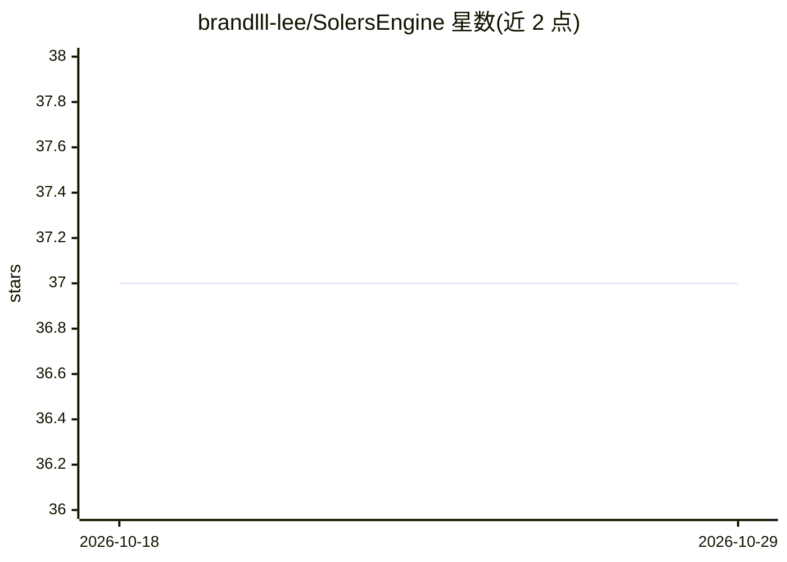

# brandlll-lee/SolersEngine

⭐ 37 · C++ · MIT · 推送 2026-09-05 · [GitHub](https://github.com/brandlll-lee/SolersEngine) · 个人维护 · 中文 README

**内嵌 AI agent 的 Godot 4.7.1 引擎分支，支持人机同库协作开发**

Solers 是基于 Godot 4.7.1 的引擎分支，核心是在编辑器内运行一个 Agent 循环（理解→修改→运行→观察→验证→继续），agent 与开发者共享同一权威 Godot 项目，通过 UndoRedo、状态前置条件、回执与检查点等引擎原生系统施加变更，变更可追溯可恢复。项目保持标准 Godot 工程格式，可手动编辑与正常发布。模型接入独立于引擎工具面，支持 ChatGPT Codex 原生 OAuth、OpenAI 兼容端点与本地推理。当前处于活跃开发期，仅从源码构建分发，需使用 Godot 4.7 构建工具链（Windows 批处理脚本或 scons）。

## 筛选速览

| 维度 | 判定 | 备注 |
|---|---|---|
| AI 角色 | `ai-enhanced` | 去掉 AI 部分产品仍成立 |
| 许可风险 | `permissive` | MIT |
| 部署形态 | `desktop` | 安装包/桌面程序 |
| 模型依赖 | — | README 未给出锁定关系 |
| 硬件要求 | — | 无带数字的原话,不猜 |
| 安装摩擦 | `low` | 无编译、无系统依赖或容器化 |
| 成熟度 | `idea` | |

## 能力要点

- 编辑器内原生 agent：观察/修改/执行/验证构成单一循环，任务可跨轮次与上下文边界延续
- 变更经 Godot 原生系统（UndoRedo、检查点、状态前置条件）施加，可追溯可恢复
- 项目保持标准 Godot 格式，可手动编辑并通过引擎工具链发布
- 模型接入支持 ChatGPT Codex OAuth、OpenAI 兼容端点与本地推理

## 适用场景

- 在 Godot 编辑器内让 AI agent 直接修改场景、脚本与资源并运行验证
- 开发者与 AI 在同一权威项目上协作迭代游戏原型
- 接入自有或本地模型进行引擎内自动化开发

## 场景标签

`编码 Agent` · 领域:编码与开发

## 证据(README 行号)

> L29: Solers is a Godot fork built around an in-engine AI agent. The agent is a
> L91: Solers is under active development and is currently distributed from source.

## 星数曲线

2026-10-18 37 → 2026-10-29 37（+0）

---
*卡片 v1 · prompt 1.4 · 生成 2026-10-25 · 置信度 high · 依据 README sha `44ad79e1c5f3` · [字段定义](../../DATASET.md)*
