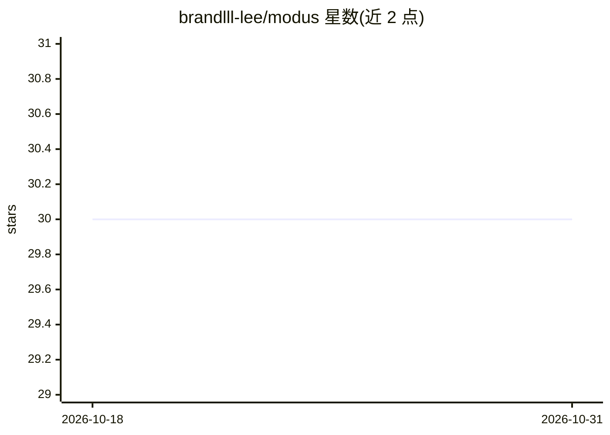

# brandlll-lee/modus

⭐ 30 · TypeScript · Apache-2.0 · 推送 2026-10-04 · [GitHub](https://github.com/brandlll-lee/modus) · 个人维护 · 中文 README

**本地优先的 AI 编码 agent 桌面工作区应用**

基于 Electron 的开源桌面应用，用于在本地真实项目中运行 AI 编码 agent：可打开工作区、连接内置或自定义 PI 兼容模型提供方、在聊天中查看文件编辑 diff，并集成 PTY 终端、带标签页的应用内浏览器与文件浏览器。支持 MCP 配置、技能与扩展，通过 ~/.pi/agent/mcp.json 与工作区级配置发现资源。当前处于早期阶段，README 称从源码运行效果最好；构建需要 Node.js、npm、Rust+Cargo 与 Git，暂无预编译安装包。

## 筛选速览

| 维度 | 判定 | 备注 |
|---|---|---|
| AI 角色 | `ai-ecosystem` | LLM/agent 周边工具 |
| 许可风险 | `permissive` | Apache-2.0 |
| 部署形态 | `library` | 以包/库形式分发 |
| 模型依赖 | — | README 未给出锁定关系 |
| 硬件要求 | — | 无带数字的原话,不猜 |
| 安装摩擦 | `low` | 无编译、无系统依赖或容器化 |
| 成熟度 | `idea` | |

## 能力要点

- 在本地项目中运行 AI 编码 agent，含工作区与独立会话管理
- 自带或自定义 PI 兼容模型提供方，可配置推理力度与模型限额
- 集成 PTY 终端、应用内浏览器（含 DevTools）与文件浏览器
- 支持 MCP 配置、项目信任规则与扩展命令

## 适用场景

- 在桌面端一站式运行编码 agent 并检查项目文件
- 为多个本地仓库维护独立的 agent 会话
- 通过 MCP 扩展接入更多工具资源

## 场景标签

`编码 Agent` · 领域:编码与开发

## 证据(README 行号)

> L17: Modus is an open-source desktop app for running AI coding agents inside real local projects.
> L26: - **Bring your own models** - Configure built-in or custom PI-compatible providers, defaults, reasoning effort, thi

## 星数曲线

2026-10-18 30 → 2026-10-31 30（+0）

---
*卡片 v1 · prompt 1.4 · 生成 2026-10-26 · 置信度 high · 依据 README sha `ae9209623623` · [字段定义](../../DATASET.md)*
