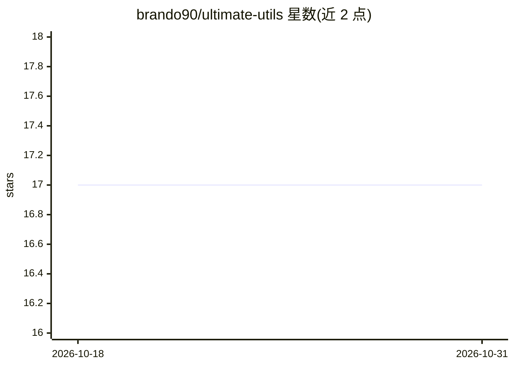

# brando90/ultimate-utils

⭐ 17 · Python · Apache-2.0 · 推送 2026-10-29 · [GitHub](https://github.com/brando90/ultimate-utils) · 个人维护

**机器学习研究的 Python 工具库：训练、统计、评测一站式工具**

由 Brando Miranda（Stanford/MIT/UIUC）个人维护的 Python 工具库，覆盖 PyTorch 训练循环与分布式训练、MAML 等元学习算法、假设检验与效应量等统计分析、LLM 评测（MATH/Putnam/OlympiadBench，支持 Claude/OpenAI/vLLM API 推理）、HuggingFace 微调（含 QLoRA/Unsloth）、W&B 日志与邮件/Discord/WhatsApp 单向通知。通知模块为脚本内发送告警，非交互式 agent。需另装 PyTorch，Apache-2.0 许可。

## 筛选速览

| 维度 | 判定 | 备注 |
|---|---|---|
| AI 角色 | `ai-ecosystem` | LLM/agent 周边工具 |
| 许可风险 | `permissive` | Apache-2.0 |
| 部署形态 | `library` | 以包/库形式分发 |
| 模型依赖 | local-ok | 支持本地模型 |
| 硬件要求 | — | 无带数字的原话,不猜 |
| 安装摩擦 | `medium` | 含编译或系统依赖之一 |
| 成熟度 | — | 结构信号不足 |

## 能力要点

- PyTorch 训练循环、分布式训练、检查点与学习率调度工具
- 元学习算法（MAML、Prototypical Networks）与配套 dataloader
- LLM 评测模块含数学基准与 Claude/OpenAI/vLLM API 推理
- 统计分析（假设检验、效应量、置信区间）与 LaTeX 表格导出

## 适用场景

- 搭建 PyTorch 训练与分布式实验流程
- 对模型做统计分析与带误差带的可视化
- 在 MATH 等数学基准上评测 LLM 并抽取答案
- 训练任务完成后通过邮件/Discord/WhatsApp 推送通知

## 场景标签

`模型评测` `微调` · 领域:评测与运维

## 证据(README 行号)

> L7: A comprehensive Python utility library for machine learning research, spanning PyTorch training infrastructure, stat
> L25: |`uutils.torch_uu`|PyTorch training loops, distributed training, checkpointing, optimizers, learning rate scheduler
> L33: |`uutils.evals`|LLM evaluation — math benchmarks (MATH, Putnam, OlympiadBench), API inference (Claude, OpenAI, vLLM

## 星数曲线

2026-10-18 17 → 2026-10-31 17（+0）

---
*卡片 v1 · prompt 1.4 · 生成 2026-10-29 · 置信度 high · 依据 README sha `49843f1d33b9` · [字段定义](../../DATASET.md)*
