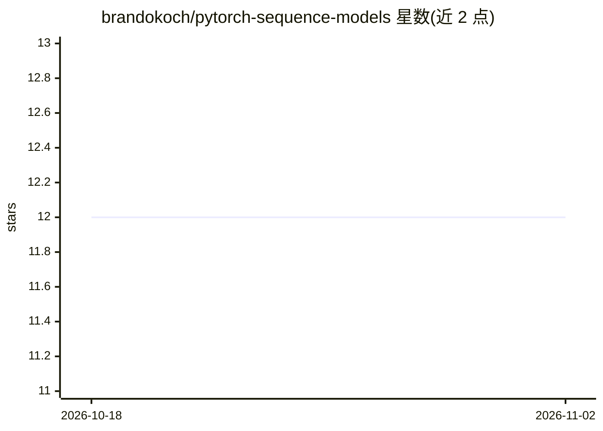

# brandokoch/pytorch-sequence-models

⭐ 12 · Python · 推送 2026-08-05 · [GitHub](https://github.com/brandokoch/pytorch-sequence-models) · 个人维护

**PyTorch 序列模型（RNN/LSTM/GRU）从零实现的教学代码库**

用纯 PyTorch 从零实现 RNN、LSTM、GRU 以及基于 RNN 的情感分类器和语言模型，代码结构面向学习用途组织。训练循环采用 fast.ai 的 learner 设计模式，通过回调提供接入点，并用 python logging 和 wandb 提供日志与可视化。用户通过 src/config.py 全局配置选择模型与超参数，运行 train.py 训练、interact.py 交互；情感分类使用 IMDb 数据集，语言模型使用 human numbers 数据集。设计说明文章与各模型原始论文链接在 README 中给出。

## 筛选速览

| 维度 | 判定 | 备注 |
|---|---|---|
| AI 角色 | `ai-native` | 本体是模型或模型工具 |
| 许可风险 | `none` | — |
| 部署形态 | `None` |  |
| 模型依赖 | — | README 未给出锁定关系 |
| 硬件要求 | — | 无带数字的原话,不猜 |
| 安装摩擦 | `low` | 无编译、无系统依赖或容器化 |
| 成熟度 | — | 结构信号不足 |

## 能力要点

- RNN/LSTM/GRU 从零实现，附架构图与论文链接
- 训练循环采用 fast.ai learner 设计模式，经 callbacks 接入
- 包含情感分类器（IMDb）与语言模型（human numbers）两个应用实现
- wandb 实验跟踪与 python logging 日志记录

## 适用场景

- 学习序列模型架构的 PyTorch 参考实现
- 作为模板搭建自己的 RNN/LSTM/GRU 训练流程
- 复现情感分类与简单语言模型训练

## 场景标签

`教程课程` · 领域:学习与行业

## 证据(README 行号)

> L2: This repository implements a variety of sequence model architectures from scratch in PyTorch . Effort has been put t
> L29: Implementation of the vanilla Recurrent Neural Network is available in `src/models/rnn.py`. This is the most basic 

## 星数曲线

2026-10-18 12 → 2026-11-02 12（+0）

---
*卡片 v1 · prompt 1.4 · 生成 2026-11-01 · 置信度 high · 依据 README sha `0a2c9c8785f9` · [字段定义](../../DATASET.md)*
