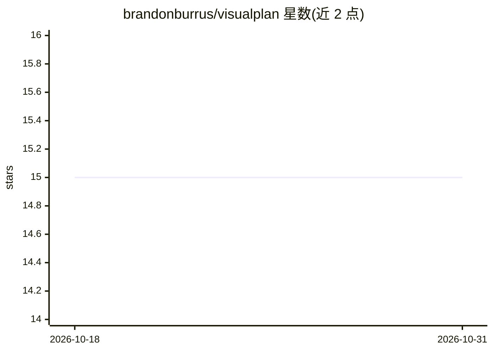

# brandonburrus/visualplan

⭐ 15 · TypeScript · MIT · 推送 2026-09-15 · [GitHub](https://github.com/brandonburrus/visualplan) · [官网](https://visualplan.dev) · 个人维护

**把 AI agent 的计划渲染为可视化网页的 CLI 与 agent 技能**

由两部分组成：vplan 是 CLI，把 MDX 格式的计划文件编译为单个自包含 HTML 页面，内置 Mermaid 图表、Chart、Phase、FileTree、Compare 等固定组件集；visual-plan 是 agent 技能，教 Claude Code、Cursor、Codex 等 agent 用该计划词汇写作。渲染后默认进入交互式 Review 模式，审阅者可评论、回答计划中的 Questions 并做出 Approve/Iterate/Deny 决定，agent 据此迭代。另提供 Review Queue 批量审阅与分享链接。

## 筛选速览

| 维度 | 判定 | 备注 |
|---|---|---|
| AI 角色 | `ai-ecosystem` | LLM/agent 周边工具 |
| 许可风险 | `permissive` | MIT |
| 部署形态 | `library` | 以包/库形式分发 |
| 模型依赖 | — | README 未给出锁定关系 |
| 硬件要求 | — | 无带数字的原话,不猜 |
| 安装摩擦 | `low` | 无编译、无系统依赖或容器化 |
| 成熟度 | — | 结构信号不足 |

## 能力要点

- MDX 计划编译为单个自包含 HTML 页面
- agent 技能适配 Claude Code、Cursor、Codex 等
- 默认交互式 Review 模式（Approve/Iterate/Deny 决策循环）
- 分享链接把整个计划编码进 URL，无需账号

## 适用场景

- 让编码 agent 输出可视化计划而非长文本
- 在写代码前与 agent 迭代收敛实现方案
- 批量审阅多个在途计划并逐个决策

## 场景标签

 · 领域:开发者工具/Agent 工作流

## 证据(README 行号)

> L10: - **`vplan`** is a CLI that renders a plan `.mdx` file to a single self-contained HTML page.
> L11: - **`visual-plan`** is an agent skill that teaches any AI agent (Claude Code, Cursor, Codex, and

## 星数曲线

2026-10-18 15 → 2026-10-31 15（+0）

---
*卡片 v1 · prompt 1.4 · 生成 2026-10-30 · 置信度 high · 依据 README sha `3ce59884e7ac` · [字段定义](../../DATASET.md)*
