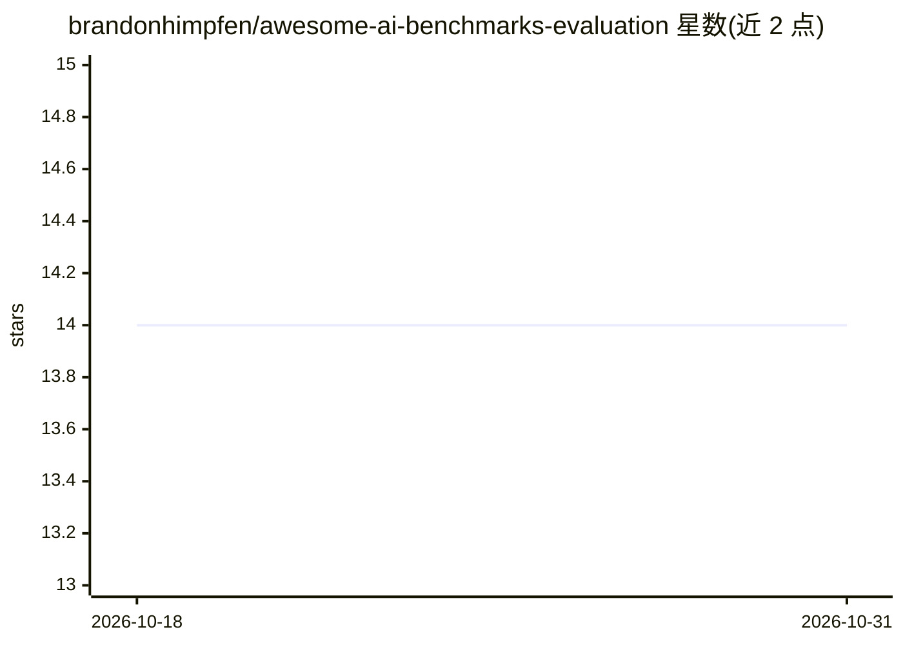

# brandonhimpfen/awesome-ai-benchmarks-evaluation

⭐ 14 · Python · 推送 2026-10-07 · [GitHub](https://github.com/brandonhimpfen/awesome-ai-benchmarks-evaluation) · [官网](https://lnktr.net/awesome) · 个人维护

**AI 评测与基准数据集的策展清单（awesome list）**

由个人维护的 awesome list，收录 AI 模型评测相关的基准数据集、排行榜、评测框架与学习资源，按通用 LLM、推理与数学、多模态、RAG、安全与鲁棒性、评测框架、数据集等类别组织，条目以名称加一句话说明的形式列出，并附相关 awesome 清单与贡献指南，以 CC0 许可发布。面向需要查找评测工具与基准的开发者和研究者。

## 筛选速览

| 维度 | 判定 | 备注 |
|---|---|---|
| AI 角色 | `ai-knowledge` | 知识聚合/清单类 |
| 许可风险 | `none` | — |
| 部署形态 | `None` |  |
| 模型依赖 | — | README 未给出锁定关系 |
| 硬件要求 | — | 无带数字的原话,不猜 |
| 安装摩擦 | `low` | 无编译、无系统依赖或容器化 |
| 成熟度 | — | 结构信号不足 |

## 能力要点

- 按 8+ 个类别组织基准与评测工具条目
- 覆盖 LLM、推理、多模态、RAG、安全鲁棒性等领域
- 包含评测框架（OpenAI Evals、TruLens、LightEval 等）与学习资源
- 附相关 awesome 清单与贡献流程（CONTRIBUTING.md）

## 适用场景

- 为模型评测项目查找合适的基准数据集
- 了解可用的 LLM 评测框架与工具
- 查找安全、鲁棒性、RAG 等特定方向的评测资源

## 场景标签

`精选清单` `模型评测` · 领域:评测与运维

## 证据(README 行号)

> L12: > A curated list of evaluation tools, benchmark datasets, leaderboards, frameworks, and resources for assessing mod
> L16: ## Contents

## 星数曲线

2026-10-18 14 → 2026-10-31 14（+0）

---
*卡片 v1 · prompt 1.4 · 生成 2026-10-31 · 置信度 high · 依据 README sha `3a04f7d12650` · [字段定义](../../DATASET.md)*
