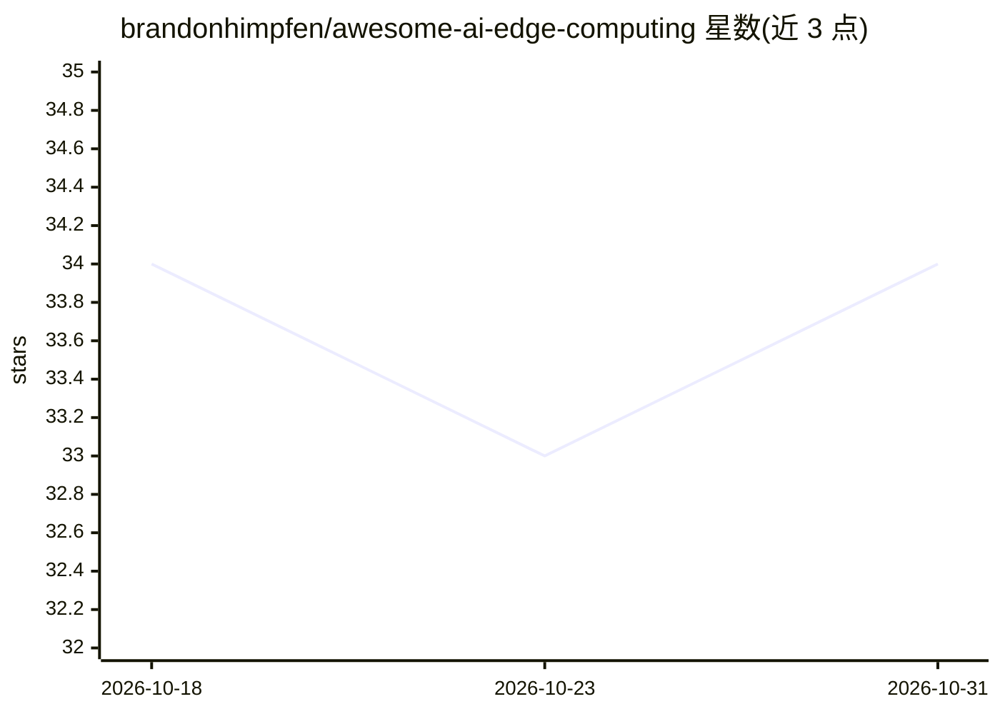

# brandonhimpfen/awesome-ai-edge-computing

⭐ 34 · Python · 推送 2026-09-06 · [GitHub](https://github.com/brandonhimpfen/awesome-ai-edge-computing) · [官网](https://lnktr.net/awesome) · 个人维护

**边缘计算 AI 工具与资源策展清单：框架、硬件、平台、教程**

一个 awesome 风格的策展清单，收录在边缘设备上运行 AI 模型的工具、框架、库与资源，覆盖智能手机、IoT 设备、嵌入式系统与硬件加速器。内容按框架与库（TensorFlow Lite、ONNX Runtime、PyTorch Mobile、Apache TVM 等）、硬件加速器（Jetson、Coral、树莓派等）、部署平台、优化工具、应用场景、学习资源与书籍分类组织。面向需要在设备本地做低时延、保护隐私推理的开发者与选型者。清单本身不含可安装运行的软件，采用 CC0 许可。

## 筛选速览

| 维度 | 判定 | 备注 |
|---|---|---|
| AI 角色 | `ai-knowledge` | 知识聚合/清单类 |
| 许可风险 | `none` | — |
| 部署形态 | `None` |  |
| 模型依赖 | — | README 未给出锁定关系 |
| 硬件要求 | — | 无带数字的原话,不猜 |
| 安装摩擦 | `low` | 无编译、无系统依赖或容器化 |
| 成熟度 | — | 结构信号不足 |

## 能力要点

- 覆盖框架、硬件、部署平台、优化工具、应用、学习资源与书籍 7 类条目
- 面向智能手机、IoT、嵌入式系统与硬件加速器的本地推理场景
- 接受社区贡献，要求遵循 CONTRIBUTING.md 规范

## 适用场景

- 为边缘 AI 项目选型框架与运行时
- 查找边缘推理硬件与加速器型号
- 寻找边缘 AI 学习课程与书籍资源

## 场景标签

`精选清单` · 领域:学习与行业

## 证据(README 行号)

> L1: # Awesome AI for Edge Computing Awesome Lists
> L11: > A curated list of awesome tools, frameworks, libraries, and resources for running AI models on edge devices, incl

## 星数曲线

2026-10-18 34 → 2026-10-31 34（+0）

---
*卡片 v1 · prompt 1.4 · 生成 2026-10-25 · 置信度 high · 依据 README sha `4e5d254c8cc7` · [字段定义](../../DATASET.md)*
