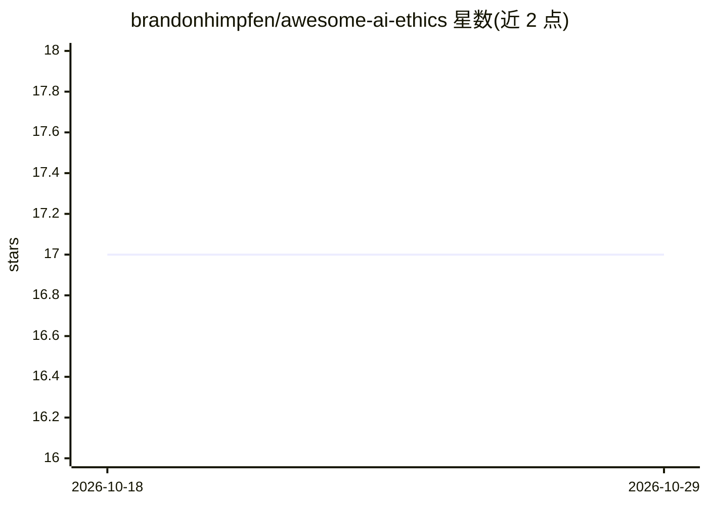

# brandonhimpfen/awesome-ai-ethics

⭐ 17 · Python · 推送 2026-09-06 · [GitHub](https://github.com/brandonhimpfen/awesome-ai-ethics) · [官网](https://lnktr.net/awesome) · 个人维护

**AI 伦理资源策展清单：框架、工具、论文与指南**

个人维护的 AI 伦理主题 awesome 清单，汇集伦理框架与指南（IEEE、EU、OECD）、偏见检测与缓解工具（AIF360、Fairlearn、SHAP 等）、可解释 AI 库、AI 治理资源、研究论文、课程与书籍，按 8 个类别组织，条目附一句描述。面向从事负责任 AI 开发与研究的人员，用于查找相关工具与阅读材料。仓库以 CC0 许可发布，接受符合 CONTRIBUTING.md 规范的贡献。

## 筛选速览

| 维度 | 判定 | 备注 |
|---|---|---|
| AI 角色 | `ai-knowledge` | 知识聚合/清单类 |
| 许可风险 | `none` | — |
| 部署形态 | `None` |  |
| 模型依赖 | — | README 未给出锁定关系 |
| 硬件要求 | — | 无带数字的原话,不猜 |
| 安装摩擦 | `low` | 无编译、无系统依赖或容器化 |
| 成熟度 | — | 结构信号不足 |

## 能力要点

- 按伦理框架、偏见检测工具、XAI、公平性、治理、论文、学习资源、书籍 8 类组织
- 收录 AIF360、Fairlearn、SHAP、LIME 等工具与 IBM/Microsoft/Google 的工具包
- 包含研究论文（Gender Shades 等）与 MIT/Coursera 课程等学习资源

## 适用场景

- 查找偏见检测与可解释 AI 工具
- 了解各国机构发布的 AI 伦理指南与原则
- 为 AI 伦理研究或学习收集论文与书籍线索

## 场景标签

`精选清单` · 领域:学习与行业

## 证据(README 行号)

> L11: > A curated list of frameworks, tools, research papers, guidelines, and resources for AI ethics, focusing on fairne
> L15: ## Ethical Frameworks and Guidelines

## 星数曲线

2026-10-18 17 → 2026-10-29 17（+0）

---
*卡片 v1 · prompt 1.4 · 生成 2026-10-29 · 置信度 high · 依据 README sha `6777fe1ed71c` · [字段定义](../../DATASET.md)*
