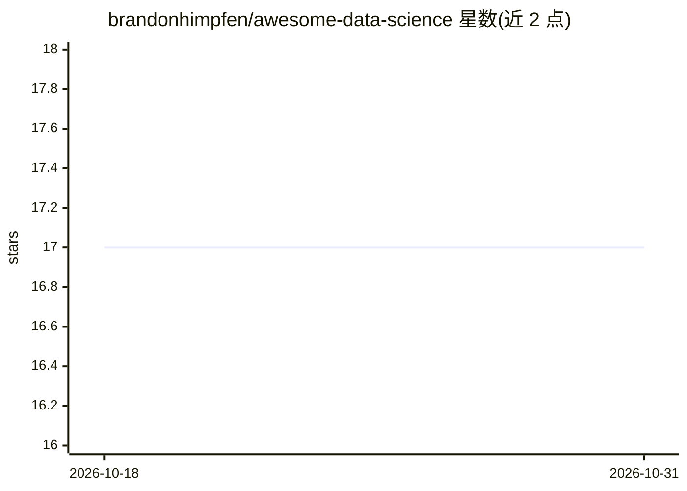

# brandonhimpfen/awesome-data-science

⭐ 17 · Python · 推送 2026-09-06 · [GitHub](https://github.com/brandonhimpfen/awesome-data-science) · [官网](https://lnktr.net/awesome) · 个人维护

**数据科学工具、数据集与学习资源的策展清单**

一个 awesome 类策展清单仓库，按类别收录数据科学相关的编程语言、数据处理与 ETL、可视化、统计、机器学习与深度学习库、时间序列、大数据、数据库、MLOps、笔记本环境、公开数据集及教程课程等条目，每条附一句用途说明。面向需要按类别查找工具、数据集和学习路径的数据科学从业者和学习者。仓库以 CC0 许可发布，通过 CONTRIBUTING.md 规范条目提交。

## 筛选速览

| 维度 | 判定 | 备注 |
|---|---|---|
| AI 角色 | `ai-knowledge` | 知识聚合/清单类 |
| 许可风险 | `none` | — |
| 部署形态 | `None` |  |
| 模型依赖 | — | README 未给出锁定关系 |
| 硬件要求 | — | 无带数字的原话,不猜 |
| 安装摩擦 | `low` | 无编译、无系统依赖或容器化 |
| 成熟度 | — | 结构信号不足 |

## 能力要点

- 覆盖 16+ 个类别：从数据获取、分析到 MLOps 生产部署
- 收录公开数据集入口（Kaggle/UCI/OpenML/世界银行等）
- 附教程、指南与课程的学习资源章节

## 适用场景

- 按类别查找数据科学各环节的候选工具
- 为项目寻找公开数据集来源
- 规划数据科学与机器学习学习路径

## 场景标签

`精选清单` · 领域:学习与行业

## 证据(README 行号)

> L12: > A curated list of tools, libraries, platforms, datasets, workflows, and learning resources for **data science**, 
> L16: ## Contents

## 星数曲线

2026-10-18 17 → 2026-10-31 17（+0）

---
*卡片 v1 · prompt 1.4 · 生成 2026-10-29 · 置信度 high · 依据 README sha `bc5485f40630` · [字段定义](../../DATASET.md)*
