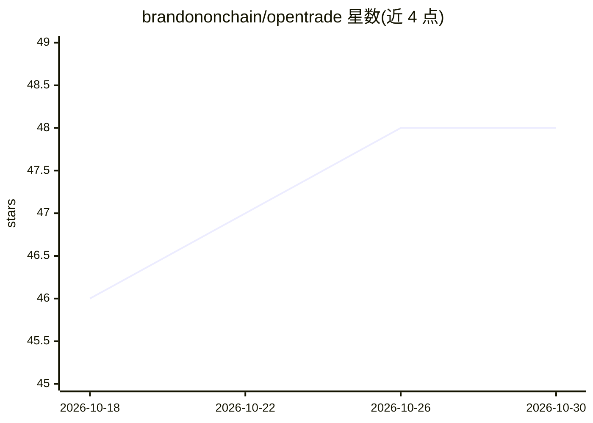

# brandononchain/opentrade

⭐ 48 · JavaScript · 推送 2026-05-17 · [GitHub](https://github.com/brandononchain/opentrade) · [官网](https://github.com/brandononchain/opentrade#readme) · 个人维护

**对话式 TradingView AI 代理：读写图表、生成回测 Pine 策略**

通过 Chrome DevTools Protocol 连接用户本地 TradingView 实时图表的 AI 代理，以 Node.js CLI 与浏览器 UI 形式提供。自然语言驱动 50 个工具：读取指标与 Pine 绘图、生成并编译 Pine Script v6 策略、在回测器中运行并读取绩效指标。内置 7 个自动激活的分析技能（量化分析、对冲基金分析、HFT 微结构、组合扫描、宏观体制、回测、Pine 开发）与 11 个 Pine 模板。支持 6 家供应商共 15 个模型，一个环境变量切换。限制：需本机运行 Node.js 18+、Chrome 与 TradingView 账号，LLM 调用需 API key 费用。

## 筛选速览

| 维度 | 判定 | 备注 |
|---|---|---|
| AI 角色 | `ai-native` | 本体是模型或模型工具 |
| 许可风险 | `permissive` | — |
| 部署形态 | `desktop` | 安装包/桌面程序 |
| 模型依赖 | locked-api |  |
| 硬件要求 | — | 无带数字的原话,不猜 |
| 安装摩擦 | `low` | 无编译、无系统依赖或容器化 |
| 成熟度 | — | 结构信号不足 |

## 能力要点

- 50 个工具直连 TradingView 实时图表（图表/Pine/数据/回放/告警等）
- 生成 Pine Script v6 策略并自动编译、回测、读取绩效指标
- 7 个自动触发分析技能与 11 个内置 Pine 模板
- 6 供应商 15 模型（Claude/GPT/Gemini/Qwen/DeepSeek/MiniMax），环境变量切换

## 适用场景

- 用自然语言让 AI 分析我的实时图表与指标
- 让 AI 生成并回测 Pine Script 交易策略
- 对我的自选列表做多标的因子打分排序
- 获取多时间框架的对冲基金式交易结构建议

## 场景标签

`金融量化` `代码生成` · 领域:编码与开发

## 证据(README 行号)

> L17: > OpenTrade connects frontier AI models to your live TradingView charts via Chrome DevTools Protocol. It reads your
> L25: - **Institutional-grade analysis skills** — quantitative regime detection, Kelly Criterion position sizing, HFT mic

## 星数曲线

2026-10-18 46 → 2026-10-30 48（+2）

---
*卡片 v1 · prompt 1.4 · 生成 2026-10-25 · 置信度 high · 依据 README sha `4225c10d436b` · [字段定义](../../DATASET.md)*
