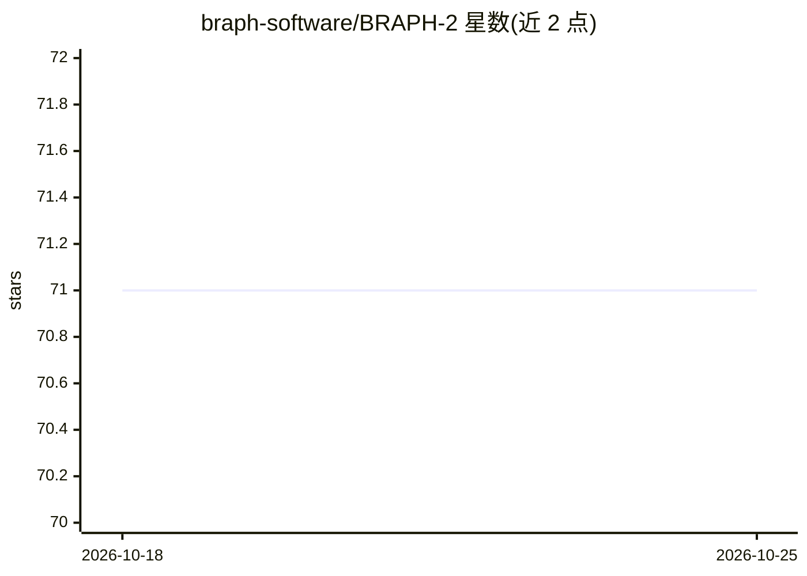

# braph-software/BRAPH-2

⭐ 71 · MATLAB · NOASSERTION · 推送 2026-07-01 · [GitHub](https://github.com/braph-software/BRAPH-2) · [官网](http://braph.org) · 组织维护

**MATLAB 脑连接组网络分析框架，供神经科学研究者做多图层与深度学习分析**

面向神经科学研究者的 MATLAB 框架，用于脑连接数据的网络分析：标准发行版提供单层/多层图论分析、图测度计算、组间比较、深度学习管线（含稠密网络、图卷积网络、VAE、蓄水池计算）以及统计工具，通过 GUI 或示例脚本运行。核心机制是 Genesis 编译器，用户以配置文件加自定义元素生成仅含所需功能的定制化无代码 GUI 发行版。限制：需 MATLAB R2022a 及以上和 Statistics and Machine Learning Toolbox，深度学习与并行计算依赖可选工具箱。

## 筛选速览

| 维度 | 判定 | 备注 |
|---|---|---|
| AI 角色 | `ai-enhanced` | 去掉 AI 部分产品仍成立 |
| 许可风险 | `none` | NOASSERTION |
| 部署形态 | `None` |  |
| 模型依赖 | — | README 未给出锁定关系 |
| 硬件要求 | — | 无带数字的原话,不猜 |
| 安装摩擦 | `low` | 无编译、无系统依赖或容器化 |
| 成熟度 | — | 结构信号不足 |

## 能力要点

- 单层/多层脑网络图论分析与组间比较管线
- 深度学习管线：稠密网络、图卷积网络、VAE、蓄水池计算
- Genesis 编译器生成定制化无代码 GUI 发行版
- CPU/GPU 并行计算支持在服务器或集群上运行脚本

## 适用场景

- 我对多模态神经影像数据做脑连接组分析并计算图测度
- 我用深度学习模型对脑连接数据做分类与预测
- 我把自己的分析方法打包成带 GUI 的定制发行版给课题组使用

## 场景标签

 · 领域:计算神经科学/生物医学工程

## 证据(README 行号)

> L11: BRAPH 2 is a MATLAB-based framework for network analysis in neurosciences. Its **standard distribution** offers adv
> L28: BRAPH 2 ships with the **standard distribution**—provided in this very repository—which offers advanced tools for m
> L42: 4. **Deep Learning Analyses**: The Standard BRAPH 2 Distribution enables the analysis of brain connectivity data us

## 星数曲线

2026-10-18 71 → 2026-10-25 71（+0）

---
*卡片 v1 · prompt 1.4 · 生成 2026-10-24 · 置信度 high · 依据 README sha `3dbf775e42e4` · [字段定义](../../DATASET.md)*
