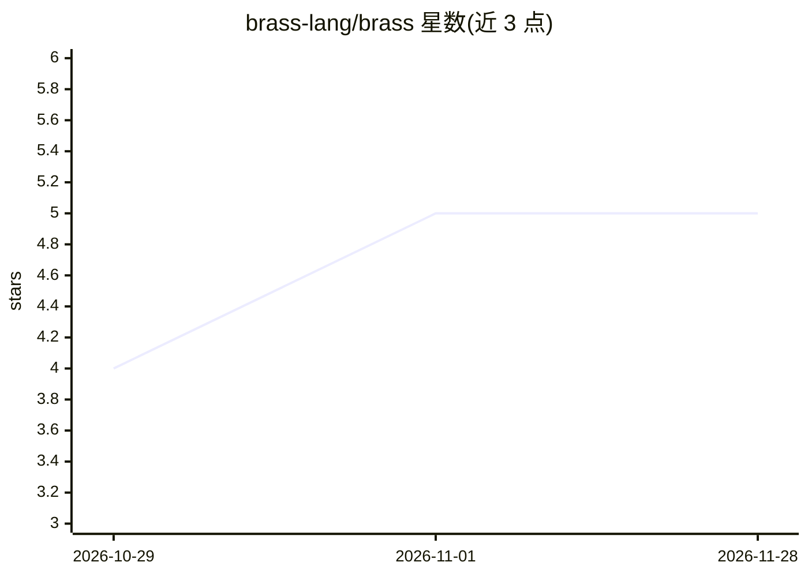

# brass-lang/brass

⭐ 5 · Python · Apache-2.0 · 推送 2026-11-24 · [GitHub](https://github.com/brass-lang/brass) · [官网](https://brass-lang.github.io/brass/) · 个人维护

**为 AI 编写、人类审核而设计的编程语言及配套工具**

Brass 是一门编程语言加配套命令行工具，目标是用更少的 token 让模型理解与修改代码。语言在函数声明中显式列出输入、承诺（promises）与外部服务权限，将 interface 与 body 分离；`brass` 工具提供声明浏览、用途查找和补丁检查。当前版本 v0.3 包含语言规范与可用工具，正式编译器与运行时尚未完成。README 附有与 Python 的 40 会话对比数据，目标场景为支付、授权、工作流等业务规则需保持清晰的软件。

## 筛选速览

| 维度 | 判定 | 备注 |
|---|---|---|
| AI 角色 | `ai-ecosystem` | LLM/agent 周边工具 |
| 许可风险 | `permissive` | Apache-2.0 |
| 部署形态 | `None` |  |
| 模型依赖 | — | README 未给出锁定关系 |
| 硬件要求 | — | 无带数字的原话,不猜 |
| 安装摩擦 | `low` | 无编译、无系统依赖或容器化 |
| 成熟度 | `idea` | |

## 能力要点

- 函数声明内显式列出输入、承诺与权限，interface 与 body 分离并由检查器验证
- `brass` 命令支持声明浏览、用途查找与补丁写入前检查
- README 提供 40 会话 Brass/Python 对比：模型调用次数、文本量与成本数据
- 规范与文档采用 CC BY 4.0，代码采用 Apache License 2.0

## 适用场景

- 让 AI 模型在权限和业务规则敏感的代码库中做修改
- 需要一个检查器证明函数承诺不被重写破坏的场景
- 研究面向 AI 编程的语言设计

## 场景标签

 · 领域:编程语言/开发工具

## 证据(README 行号)

> L7: Brass is a language designed to help AI models spend fewer tokens understanding and changing code. The language itse
> L13: 3. **Own Code Discovery and Changes.** The `brass` command shows declarations, finds their uses and checks patches 
> L15: Brass v0.3 includes the language specification and a working tool for navigating, editing and checking code. The to

## 星数曲线

2026-10-29 4 → 2026-11-28 5（+1）

---
*卡片 v1 · prompt 1.4 · 生成 2026-11-21 · 置信度 mid · 依据 README sha `54d95d538731` · [字段定义](../../DATASET.md)*
