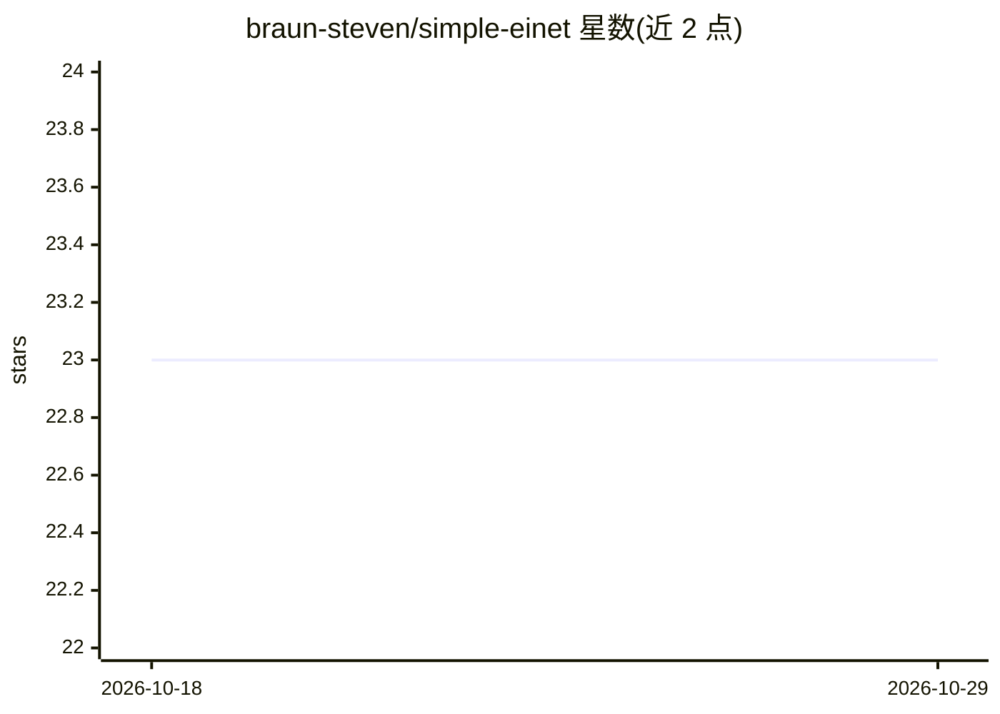

# braun-steven/simple-einet

⭐ 23 · Jupyter Notebook · MIT · 推送 2026-01-26 · [GitHub](https://github.com/braun-steven/simple-einet) · 个人维护

**PyTorch 的 EinsumNetworks（和积网络）实现库**

作者个人的 EinsumNetworks（Einet，tractable probabilistic circuits / sum-product networks）PyTorch 实现库。提供 Normal/Binomial 等分布层与 Einet 模型构建、训练与采样 API；附 Jupyter notebooks 演示判别式训练（iris）、生成式训练（MNIST）与合成多元正态数据，另提供基于 PyTorch Lightning 的训练脚本 main_pl.py（支持分类与生成、可指定 GPU）。通过 pip 从 GitHub 安装，可选 [app] 附加依赖以运行脚本与 notebooks。

## 筛选速览

| 维度 | 判定 | 备注 |
|---|---|---|
| AI 角色 | `ai-native` | 本体是模型或模型工具 |
| 许可风险 | `permissive` | MIT |
| 部署形态 | `library` | 以包/库形式分发 |
| 模型依赖 | — | README 未给出锁定关系 |
| 硬件要求 | — | 无带数字的原话,不猜 |
| 安装摩擦 | `low` | 无编译、无系统依赖或容器化 |
| 成熟度 | — | 结构信号不足 |

## 能力要点

- 提供 Einet 模型构建、优化与采样的 Python API
- 基于 PyTorch Lightning 的判别式/生成式训练脚本（可指定 GPU）
- 附 iris/MNIST/合成正态数据的 Jupyter notebooks 示例
- 支持以 pip 从 GitHub 安装，[app] 附加脚本依赖

## 适用场景

- 用 PyTorch 训练判别式或生成式和积网络
- 在 MNIST 等数据集上做概率电路的建模与采样实验
- 研究中复现或扩展 EinsumNetworks 方法

## 场景标签

`模型训练` · 领域:训练与推理

## 证据(README 行号)

> L5: # An EinsumNetworks Implementation
> L19: The `main_pl.py` script offers PyTorch-Lightning based training for discriminative and generative Einets.

## 星数曲线

2026-10-18 23 → 2026-10-29 23（+0）

---
*卡片 v1 · prompt 1.4 · 生成 2026-10-27 · 置信度 high · 依据 README sha `feaba704bd4e` · [字段定义](../../DATASET.md)*
