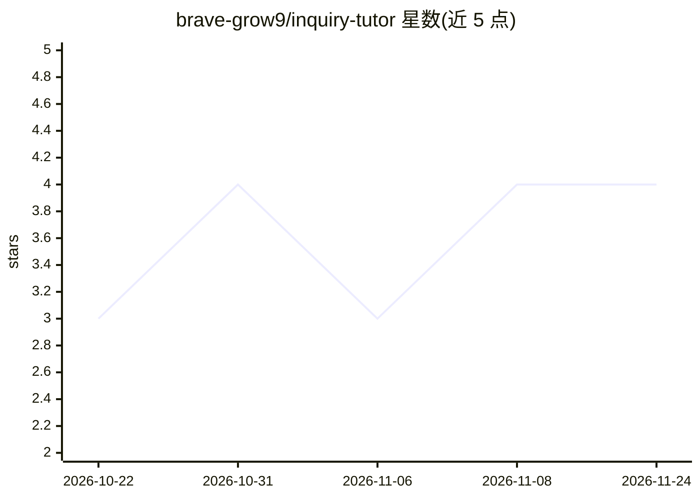

# brave-grow9/inquiry-tutor

⭐ 4 · MIT · 推送 2026-10-13 · [GitHub](https://github.com/brave-grow9/inquiry-tutor) · 个人维护 · 中文 README

**用苏格拉底式提问带你入门新领域的 AI 教学 skill**

一组纯文本指令形式的 AI skill：不给答案，而是逐个提问，引导学习者自己解释概念，直到能自述为止。规则包括一次只问一个问题、答错时降级为更简单的问题。每轮结束后生成四部分学习笔记（所学内容、推理路径原文、卡点、自检题），并携带进度以便续学；支持指定书籍/论文/文档/文件夹作为学习素材，提供三种素材模式。兼容 Agent Skills 开放标准，可安装到 Claude Code、Codex CLI、Cursor 等多个客户端。无脚本、无网络请求。

## 筛选速览

| 维度 | 判定 | 备注 |
|---|---|---|
| AI 角色 | `ai-native` | 本体是模型或模型工具 |
| 许可风险 | `permissive` | MIT |
| 部署形态 | `None` |  |
| 模型依赖 | — | README 未给出锁定关系 |
| 硬件要求 | — | 无带数字的原话,不猜 |
| 安装摩擦 | `low` | 无编译、无系统依赖或容器化 |
| 成熟度 | — | 结构信号不足 |

## 能力要点

- 苏格拉底式提问循环：一次一问、永不直接给答案
- 每轮生成含推理路径与卡点记录的四部分学习笔记
- 支持自有素材的三种模式（主导/跟随/参考）
- 符合 Agent Skills 开放标准，一份拷贝适配多个 CLI 客户端

## 适用场景

- 从零学一个新领域（如行为经济学），以问答驱动理解
- 跟随一本书或论文做结构化学习
- 保存学习卡点与自检题，之后续学

## 场景标签

 · 领域:教育/学习工具

## 证据(README 行号)

> L3: **An AI skill that teaches you a new field by asking — not by telling.**
> L15: Inquiry Tutor flips it: instead of explaining things to you, it **asks you questions until you can explain them you
> L116: **This skill contains no scripts and makes no network requests.**

## 星数曲线

2026-10-22 3 → 2026-11-24 4（+1）

---
*卡片 v1 · prompt 1.4 · 生成 2026-11-21 · 置信度 mid · 依据 README sha `0cc7107db691` · [字段定义](../../DATASET.md)*
