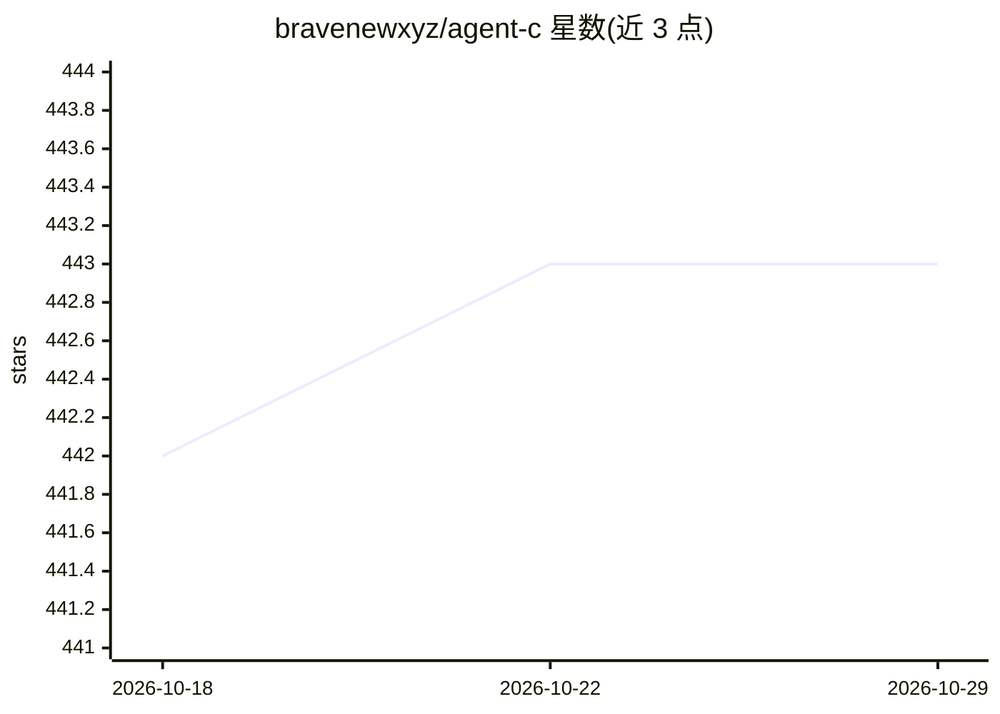

# bravenewxyz/agent-c

⭐ 443 · C · 推送 2026-03-05 · [GitHub](https://github.com/bravenewxyz/agent-c) · [官网](https://bravenew.xyz) · 个人维护

**C 语言编写的超轻量 AI Agent，接入 OpenRouter 执行 shell 命令**

单文件 C 实现的命令行 AI agent：通过 macOS SecureTransport 原生 TLS 连接 OpenRouter API，发送带 sh 工具定义的消息并流式输出响应；模型返回 tool_calls 时执行 shell 命令并回传结果，每轮最多 5 次工具调用。零第三方依赖，编译后约 4KB 二进制，保留最近 20 条消息的滑动窗口记忆。支持 macOS 与 Linux，通过 make 构建，许可证为 CC0。

## 筛选速览

| 维度 | 判定 | 备注 |
|---|---|---|
| AI 角色 | `ai-native` | 本体是模型或模型工具 |
| 许可风险 | `none` | — |
| 部署形态 | `None` |  |
| 模型依赖 | locked-api |  |
| 硬件要求 | — | 无带数字的原话,不猜 |
| 安装摩擦 | `low` | 无编译、无系统依赖或容器化 |
| 成熟度 | — | 结构信号不足 |

## 能力要点

- 零依赖，原生 TLS（macOS SecureTransport），约 4KB 单文件二进制
- OpenAI 兼容 tools API 实现 shell 命令执行工具调用
- SSE 流式输出 token
- 滑动窗口 20 条消息的对话记忆

## 适用场景

- 在终端以自然语言驱动 shell 命令执行
- 需要一个极小体积、无依赖的可编译 AI agent
- 通过 OpenRouter 调用多种模型完成命令行任务

## 场景标签

`AI 助手` · 领域:对话与助手

## 证据(README 行号)

> L3: An ultra-lightweight AI agent written in C that communicates with OpenRouter API and executes shell commands.
> L35: The agent connects to OpenRouter, sends messages with a `sh` tool definition, and streams the response. When the mo

## 星数曲线

2026-10-18 442 → 2026-10-29 443（+1）

---
*卡片 v1 · prompt 1.4 · 生成 2026-10-21 · 置信度 high · 依据 README sha `6876a2ed8130` · [字段定义](../../DATASET.md)*
