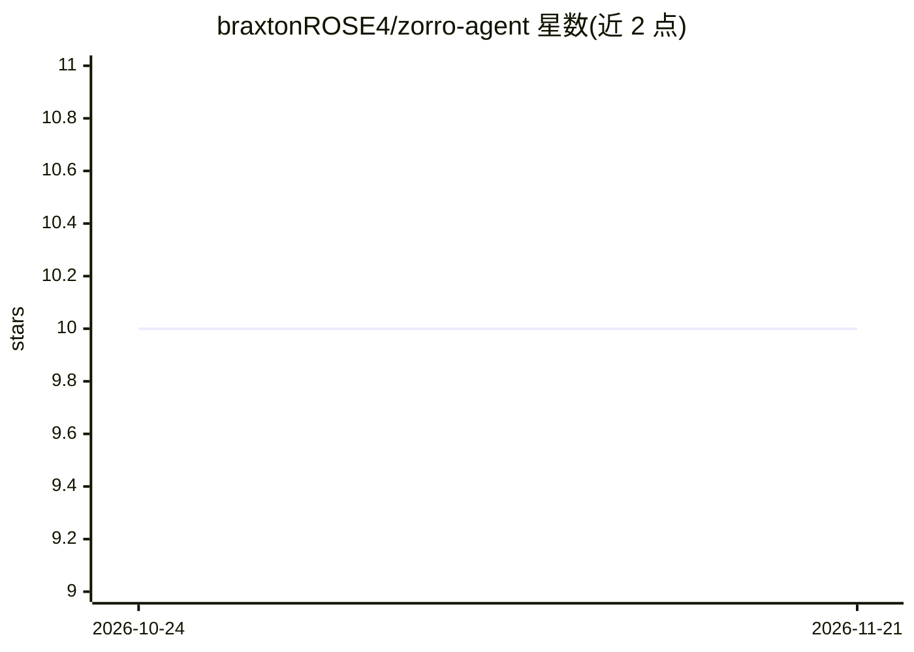

# braxtonROSE4/zorro-agent

⭐ 10 · Python · MIT · 推送 2026-04-14 · [GitHub](https://github.com/braxtonROSE4/zorro-agent) · 个人维护

**自进化 CLI agent：将使用经验转化为领域知识与可执行技能**

Python CLI agent 框架，核心是经验进化循环：每轮对话用正则引擎检测 8 类学习信号，按触发条件（固定间隔/高置信信号/用户挫败感）启动审查，将教训写入按领域分区的知识库，可复用流程经用户确认后固化为 YAML+Markdown 技能文件。另有工具输出压缩（超过 8K 字符由廉价模型蒸馏）、FTS5 会话全文检索、SOUL.md 身份配置。支持 19 个消息平台接入、200+ 模型、6 种运行后端。需 Python 3.11+，模型接入需 API key。

## 筛选速览

| 维度 | 判定 | 备注 |
|---|---|---|
| AI 角色 | `ai-ecosystem` | LLM/agent 周边工具 |
| 许可风险 | `permissive` | MIT |
| 部署形态 | `library` | 以包/库形式分发 |
| 模型依赖 | local-ok | 支持本地模型 |
| 硬件要求 | — | 无带数字的原话,不猜 |
| 安装摩擦 | `low` | 无编译、无系统依赖或容器化 |
| 成熟度 | — | 结构信号不足 |

## 能力要点

- 8 类学习信号的自动检测（EN/ZH 双语，零 API 成本）
- 领域分区知识库 + 经验固化为 YAML+Markdown 技能（用户确认制）
- FTS5 会话全文检索与结构化会话总结
- 19 平台接入、OpenRouter/OpenAI/Anthropic/Ollama 等 200+ 模型可切换

## 适用场景

- 在终端中运行一个能积累个人工作模式、越用越贴合自己流程的 agent
- 通过 Telegram/Discord/飞书等平台与个人 agent 交互
- 把重复调试流程固化为可复用的技能文件
- 让 agent 记住项目约定与踩坑教训并在后续会话中检索

## 场景标签

`Agent 框架` `Agent 记忆` · 领域:Agent 开发

## 证据(README 行号)

> L11: **A self-evolving CLI agent.** Most agents treat memory as an afterthought — a flat text file that grows until it's
> L129:  Full TUI prompt_toolkit — multiline editing, slash commands, tab completion, streaming, interrupt handling, conve

## 星数曲线

2026-10-24 10 → 2026-11-21 10（+0）

---
*卡片 v1 · prompt 1.4 · 生成 2026-11-19 · 置信度 high · 依据 README sha `316aa762f547` · [字段定义](../../DATASET.md)*
