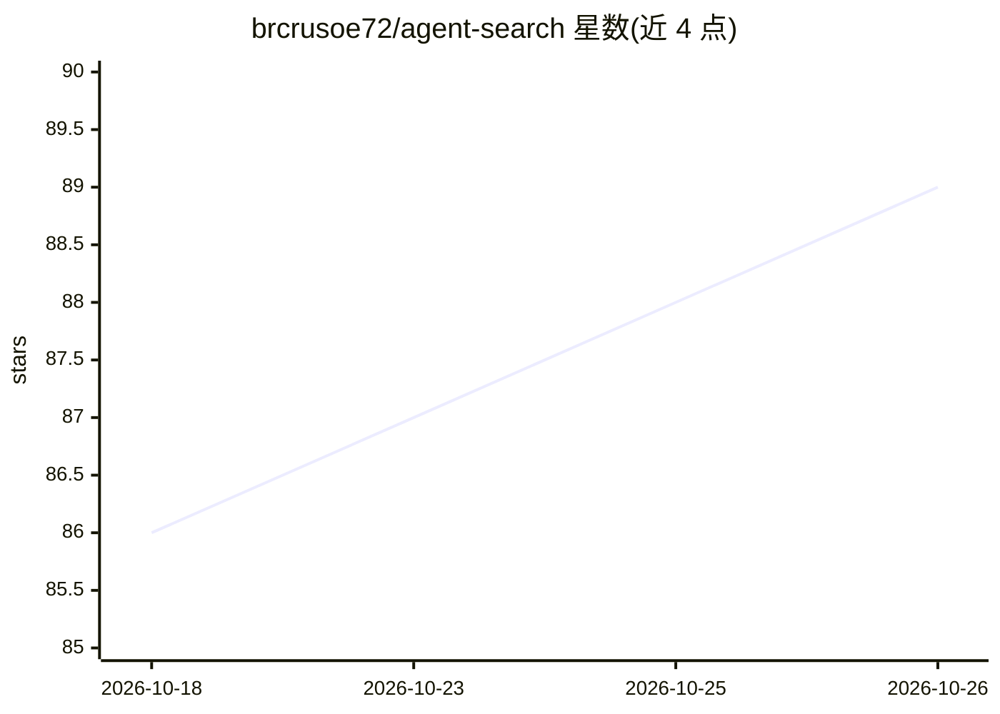

# brcrusoe72/agent-search

⭐ 89 · Python · MIT · 推送 2026-10-15 · [GitHub](https://github.com/brcrusoe72/agent-search) · [官网](https://pypi.org/project/agentsearch-client/) · 个人维护

**面向 AI agent 的自托管搜索 API，捆绑 SearXNG，无需第三方 API key**

在 SearXNG 之上封装 FastAPI 层，向 AI agent 提供多引擎去重搜索、跨引擎评分、递进式内容提取（含浏览器渲染、Wayback Machine、PDF、YouTube 字幕）、查询扩展、域名信任评分、提示注入清洗与失败模式分析等能力。支持 Docker Compose 一键部署与原生 Python 运行，可选 Tor 匿名私有栈与本地 bearer 认证。提供 Python SDK、LangChain 工具示例与 MCP server，可接入 Claude Desktop、Cursor、Windsurf。

## 筛选速览

| 维度 | 判定 | 备注 |
|---|---|---|
| AI 角色 | `ai-ecosystem` | LLM/agent 周边工具 |
| 许可风险 | `permissive` | MIT |
| 部署形态 | `self-host` | docker 或自建部署 |
| 模型依赖 | — | README 未给出锁定关系 |
| 硬件要求 | — | 无带数字的原话,不猜 |
| 安装摩擦 | `low` | 无编译、无系统依赖或容器化 |
| 成熟度 | — | 结构信号不足 |

## 能力要点

- SearXNG 之上的 FastAPI 搜索 API，无需第三方搜索 API key
- 10 级递进式内容提取链（含浏览器渲染、Wayback、PDF、YouTube 字幕）
- 7 种策略搜索模式（general/code/academic/news 等）与深度查询扩展
- MCP server 可接入 Claude Desktop、Cursor、Windsurf；可选 Tor 匿名私有栈

## 适用场景

- 给 AI agent 提供自托管、无按次计费的网页搜索与内容提取服务
- RAG 流程中获取带提取内容的搜索结果
- 需要匿名搜索路径时启用 Tor 私有栈

## 场景标签

`网页抓取` · 领域:效率与自动化

## 证据(README 行号)

> L3: Self-hosted search API for AI agents. Layered content extraction with isolated browser rendering. Optional Tor-anony
> L73: AgentSearch wraps SearXNG with a FastAPI layer that adds the pieces agents usually need on top of raw search: dedup
> L264: ### MCP server (Claude Desktop, Cursor, Windsurf)

## 星数曲线

2026-10-18 86 → 2026-10-26 89（+3）

---
*卡片 v1 · prompt 1.4 · 生成 2026-10-23 · 置信度 high · 依据 README sha `92574425119e` · [字段定义](../../DATASET.md)*
