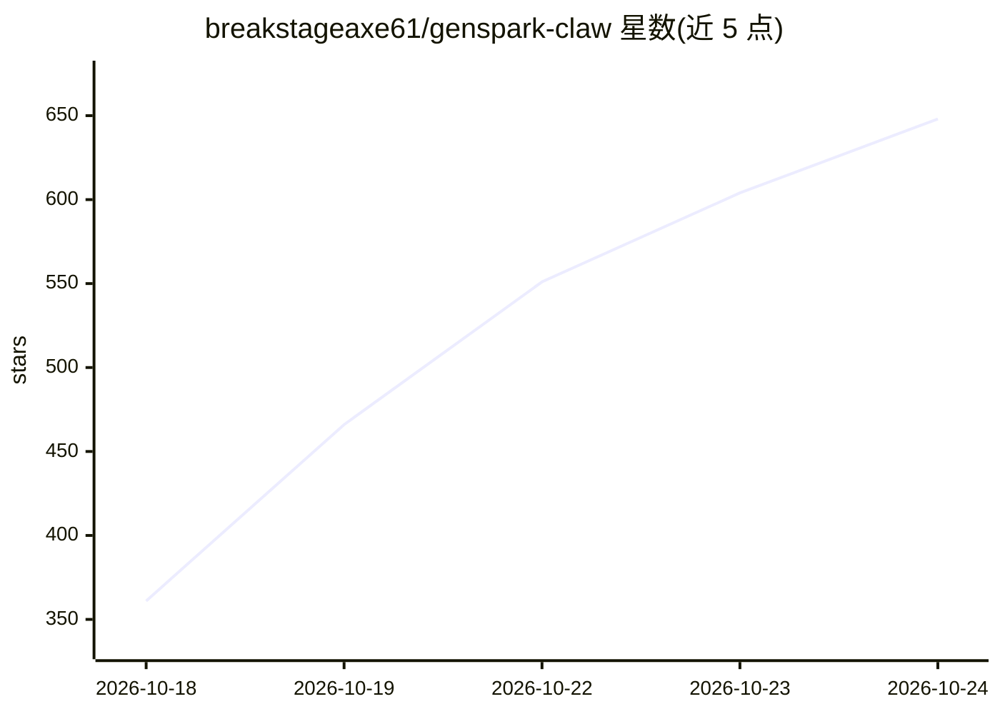

# breakstageaxe61/genspark-claw

⭐ 538 · JavaScript · MIT · 推送 2026-09-26 · [GitHub](https://github.com/breakstageaxe61/genspark-claw) · 个人维护

**给个人 AI agent 安装生产级技能的社区技能包与 CLI**

面向 Genspark Claw、OpenClaw、Hermes 等 agent 运行时的社区技能包：内含 5 个 SKILL.md 格式技能（深度研究、报告、幻灯片大纲、浏览器自动化、AI 电话准备），通过零依赖的 Node.js CLI 一行安装到各 agent 的技能目录，并附带暴露 list_skills/get_skill/validate_skill 工具的 MCP 服务器。内置校验器审计技能中的管道远程执行、base64 载荷与破坏性命令。需 Node.js ≥ 18，项目声明与 Genspark 等官方无隶属关系。

## 筛选速览

| 维度 | 判定 | 备注 |
|---|---|---|
| AI 角色 | `ai-ecosystem` | LLM/agent 周边工具 |
| 许可风险 | `permissive` | MIT |
| 部署形态 | `library` | 以包/库形式分发 |
| 模型依赖 | — | README 未给出锁定关系 |
| 硬件要求 | — | 无带数字的原话,不猜 |
| 安装摩擦 | `low` | 无编译、无系统依赖或容器化 |
| 成熟度 | — | 结构信号不足 |

## 能力要点

- 5 个 SKILL.md 技能：深度研究、报告、幻灯片、浏览器自动化、AI 电话准备
- 零运行时依赖，纯 Node.js ≥ 18 标准库
- 技能安装前经安全校验器审计（管道执行/base64/破坏性命令）
- 附带零依赖 MCP 服务器，可接入 Claude Desktop、Cursor、Windsurf

## 适用场景

- 给自己的 OpenClaw/Hermes/Genspark Claw agent 一键安装研究与自动化技能
- 通过 MCP 把技能包暴露给 Claude Desktop 或 Cursor
- 基于现有 SKILL.md fork 编写并发布自定义技能

## 场景标签

`浏览器自动化` `科研工具` · 领域:效率与自动化

## 证据(README 行号)

> L3: ### The community skill pack & CLI for **Genspark Claw**, **OpenClaw**, and **Hermes** agents
> L84: npx genspark-claw install all --target openclaw
> L122: genspark-claw ships a **zero-dependency Model Context Protocol server** that exposes the pack as tools (`list_skil

## 星数曲线

2026-10-18 361 → 2026-10-24 648（+287）

---
*卡片 v1 · prompt 1.4 · 生成 2026-10-21 · 置信度 high · 依据 README sha `721f5880de17` · [字段定义](../../DATASET.md)*
