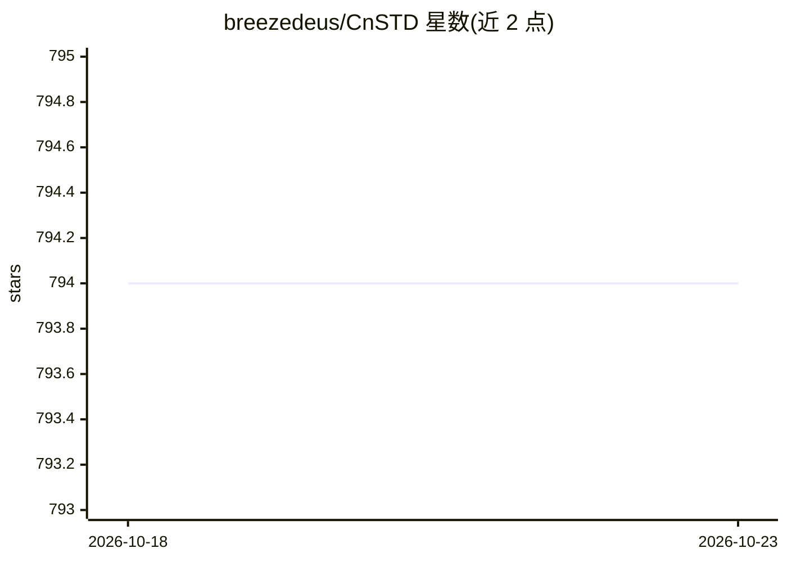

# breezedeus/CnSTD

⭐ 794 · Python · Apache-2.0 · 推送 2026-07-05 · [GitHub](https://github.com/breezedeus/CnSTD) · [官网](https://www.breezedeus.com/article/cnocr) · 个人维护 · 中文 README

**中文/英文场景文字检测、数学公式检测与版面分析的 Python 包**

基于 PyTorch 的 Python 3 工具包，提供三类检测能力：场景文字检测（自带 DBNet 自训模型及 PaddleOCR PP-OCRv2~v6 外部 ONNX 模型，支持多语种与竖排文字）、数学公式检测（区分行内/独立行公式，YOLOv7 架构）与版面分析（识别 10 类版面元素）。模型首次使用自动下载，提供 CnStd/LayoutAnalyzer 类与 cnstd predict/analyze/train/resave 命令行工具。限制：PP-OCR 外部模型不支持领域数据精调；部分 YoloV7 模型仅对付费星球会员开放。文字识别需配合 cnocr 使用。

## 筛选速览

| 维度 | 判定 | 备注 |
|---|---|---|
| AI 角色 | `ai-native` | 本体是模型或模型工具 |
| 许可风险 | `permissive` | Apache-2.0 |
| 部署形态 | `library` | 以包/库形式分发 |
| 模型依赖 | — | README 未给出锁定关系 |
| 硬件要求 | — | 无带数字的原话,不猜 |
| 安装摩擦 | `medium` | 含编译或系统依赖之一 |
| 成熟度 | — | 结构信号不足 |

## 能力要点

- 自带 DBNet 训练模型，安装后直接使用，支持 PyTorch/ONNX 双后端
- 集成 PP-OCRv2~v6 多语种检测模型（ONNX 版，不依赖 PaddlePaddle）
- MFD 区分行内/独立行公式，版面分析识别 10 类元素，同出 LayoutAnalyzer 类
- 提供 cnstd predict/analyze/train/resave CLI 工具

## 适用场景

- 检测图片中的中英文文本框，配合 cnocr 完成完整 OCR
- 从文档截图中定位行内与独立行数学公式
- 识别文档图片的正文/标题/表格等 10 类版面元素
- 用自己的数据训练文本检测模型

## 场景标签

`OCR` `目标检测` `文档解析` · 领域:知识与检索

## 证据(README 行号)

> L56: **CnSTD** 是 **Python 3** 下的**场景文字检测**（**Scene Text Detection**，简称**STD**）工具包，支持**中文**、**英文**等语言的文字检测，自带了多个训练好的检测模型，
> L82: MFD 模型检测图片中包含的数学公式，其中行内的公式检测为 `embedding` 类别，独立行的公式检测为 `isolated`。模型训练使用了英文 IBEM 和中文 CnMFD_Dataset 两个数据集。
> L92: 版面分析模型识别图片中的不同排版元素。模型训练使用的是 CDLA 数据集。可识别以下10中版面元素：

## 星数曲线

2026-10-18 794 → 2026-10-23 794（+0）

---
*卡片 v1 · prompt 1.4 · 生成 2026-10-21 · 置信度 high · 依据 README sha `5579900e951a` · [字段定义](../../DATASET.md)*
