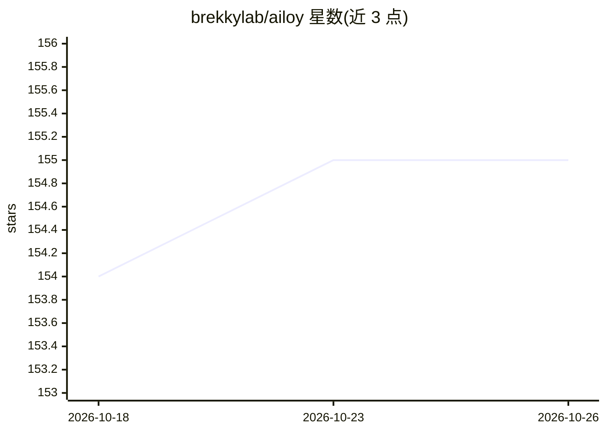

# brekkylab/ailoy

⭐ 155 · Rust · Apache-2.0 · 推送 2026-10-25 · [GitHub](https://github.com/brekkylab/ailoy) · [官网](https://brekkylab.github.io/ailoy/) · 组织维护

**给每个 AI agent 配 microVM 沙箱的 agent 构建库**

面向开发者的 AI agent 构建库，提供 Python、Node.js（TypeScript）与 Rust 三种 API，支持 Linux、Windows 和 macOS。核心机制是基于 krun 的虚拟化：每个 agent 获得独立的 microVM，可在其中安装软件、编写脚本、运行代码，并支持 GPU 直通以在 VM 内运行 ML 模型或游戏。模型接入默认经由提供商 CLI（Claude Code、Codex、Gemini CLI），也可通过 API key 或 Bedrock、OpenRouter、vLLM 后端。README 声明项目处于活跃开发中，API 可能随版本变化。附带多个示例（CAD 建模、图像分割、TTS、游戏等）。

## 筛选速览

| 维度 | 判定 | 备注 |
|---|---|---|
| AI 角色 | `ai-ecosystem` | LLM/agent 周边工具 |
| 许可风险 | `permissive` | Apache-2.0 |
| 部署形态 | `library` | 以包/库形式分发 |
| 模型依赖 | local-ok | 支持本地模型 |
| 硬件要求 | — | 无带数字的原话,不猜 |
| 安装摩擦 | `low` | 无编译、无系统依赖或容器化 |
| 成熟度 | `idea` | |

## 能力要点

- 每个 agent 独立 microVM（krun 虚拟化），无需单独 VM 守护进程
- VM 内支持 GPU（Vulkan/Metal），可运行 ML 模型与游戏
- Python / Node.js / Rust 三语言 API
- 支持 Claude Code、Codex、Gemini CLI 及 Bedrock、OpenRouter、vLLM 等后端

## 适用场景

- 在自己的代码里构建能安装软件、写脚本、操作通用计算环境的 agent
- 构建在沙箱 GPU 上运行 ML 模型（分割、TTS 等）的 agent
- 让 agent 在隔离 VM 中执行代码而不触碰宿主系统

## 场景标签

`Agent 框架` · 领域:Agent 开发

## 证据(README 行号)

> L14: Ailoy is a library for building any kind of AI agents right in your own code.
> L153: To make this possible, Ailoy uses krun-based virtualization to **give each agent a virtual machine of its own**, w
> L155: The virtualization used in Ailoy also **supports the GPU**, so an agent can run ML models, or even games, inside i

## 星数曲线

2026-10-18 154 → 2026-10-26 155（+1）

---
*卡片 v1 · prompt 1.4 · 生成 2026-10-23 · 置信度 high · 依据 README sha `c99f0aa7ecc7` · [字段定义](../../DATASET.md)*
