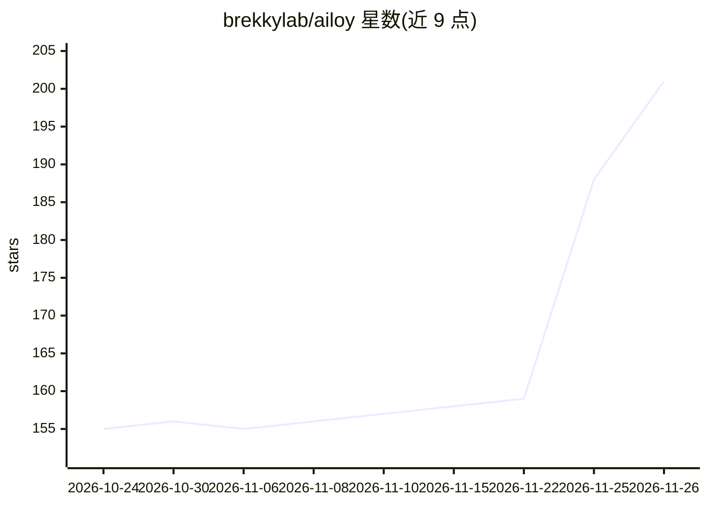

# brekkylab/ailoy

⭐ 201 · Rust · Apache-2.0 · 推送 2026-11-25 · [GitHub](https://github.com/brekkylab/ailoy) · [官网](https://ailoy.co) · 组织维护

**给每个 Agent 配独立 microVM 沙箱的开源 SDK**

Ailoy 是构建 AI Agent 的开源 SDK，将 agent 循环与沙箱合并在一个 SDK 中：宿主机上的 SDK 负责向模型发送提示、执行工具调用并判断 agent 结束；virtx 组件基于 krun 为每个 agent 分配一台独立 Linux VM 作为沙箱，agent 可在其中安装软件、编写运行代码、保存文件，并支持 GPU 直通以运行 ML 模型。提供 Python、TypeScript 与 Rust 三种 API，支持 Linux/Windows/macOS。默认经各模型的 CLI 调用，也可配置 API key；项目声明处于活跃开发中，API 可能随版本变化。

## 筛选速览

| 维度 | 判定 | 备注 |
|---|---|---|
| AI 角色 | `ai-ecosystem` | LLM/agent 周边工具 |
| 许可风险 | `permissive` | Apache-2.0 |
| 部署形态 | `library` | 以包/库形式分发 |
| 模型依赖 | local-ok | 支持本地模型 |
| 硬件要求 | — | 无带数字的原话,不猜 |
| 安装摩擦 | `low` | 无编译、无系统依赖或容器化 |
| 成熟度 | `idea` | |

## 能力要点

- 每个 agent 配备独立 Linux microVM 沙箱（基于 krun）
- 支持 Python、TypeScript、Rust 三语言 API，跨 Linux/Windows/macOS
- 沙箱内支持 GPU（Vulkan/Metal），可运行 ML 模型
- 模型调用默认走 Claude Code/Codex/Gemini CLI，也可切换 API 或自建后端

## 适用场景

- 构建能自己写代码、装依赖、跑 ML 模型的 agent
- 让 agent 在隔离沙箱中操作文件而不触碰宿主机
- 用 Rust/Python/Node 嵌入式集成 agent 能力

## 场景标签

`Agent 框架` · 领域:Agent 开发

## 证据(README 行号)

> L3:  The open-source agent SDK that gives every agent its own VM.
> L14: Ailoy is an open-source SDK for building AI agents right in your own code. Every agent gets a Linux VM of its own a
> L137: - The **Ailoy SDK** runs the agent loop on your host. It sends the prompt to the model, runs the tool calls the mo
> L138: - **virtx** gives each agent a Linux VM of its own, built on krun, with no separate VM daemon to install. The VM i

## 星数曲线

2026-10-24 155 → 2026-11-26 201（+46）

---
*卡片 v1 · prompt 1.4 · 生成 2026-11-26 · 置信度 high · 依据 README sha `c204d000734c` · [字段定义](../../DATASET.md)*
