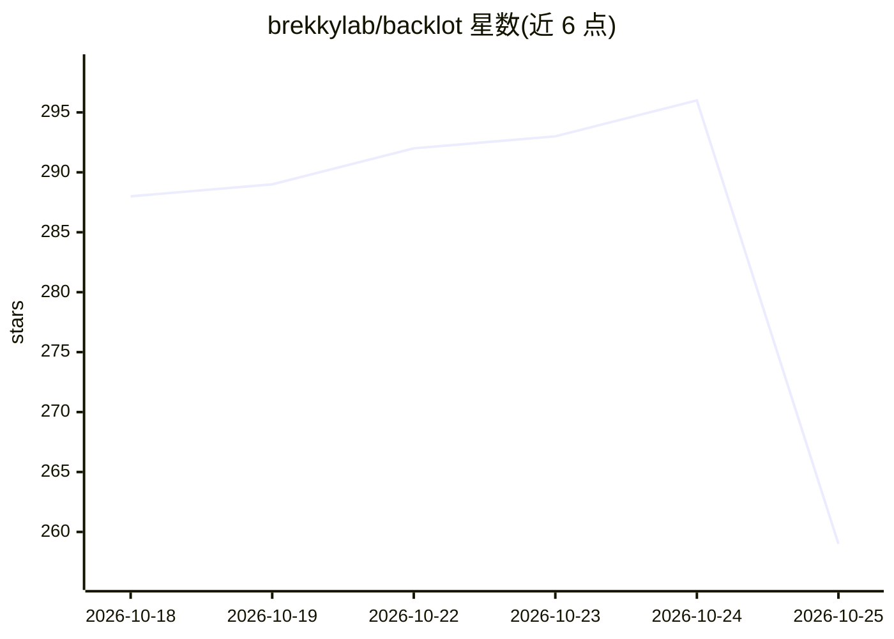

# brekkylab/backlot

⭐ 259 · Python · Apache-2.0 · 推送 2026-10-23 · [GitHub](https://github.com/brekkylab/backlot) · [官网](https://pypi.org/project/backlot) · 组织维护

**本地运行的企业 SaaS API 模拟器：Slack/Gmail/GitHub 等集成开发测试**

在本地单进程模拟 Slack、Gmail、Google Drive、GitHub、Jira、Confluence、Notion、Linear、HubSpot、Fireflies、S3 等 11 个企业 API，复现响应结构、分页、认证、错误与按文档 ACL，数据来自用户提供的确定性 SQLite/JSONL 语料库。开发者改一个 base URL 即可用官方 vendor SDK 开发和测试集成，无需厂商账号、OAuth 审批、CI 密钥或网络。支持以 MCP 工具形式（backlot mcp）或插件接入 Claude/Codex 等 coding agent，也用于 RAG/agent 评测的稳定数据源。仅实现各 API 的文档化子集。

## 筛选速览

| 维度 | 判定 | 备注 |
|---|---|---|
| AI 角色 | `ai-ecosystem` | LLM/agent 周边工具 |
| 许可风险 | `permissive` | Apache-2.0 |
| 部署形态 | `library` | 以包/库形式分发 |
| 模型依赖 | — | README 未给出锁定关系 |
| 硬件要求 | — | 无带数字的原话,不猜 |
| 安装摩擦 | `low` | 无编译、无系统依赖或容器化 |
| 成熟度 | — | 结构信号不足 |

## 能力要点

- 11 个企业 SaaS API 单进程模拟，官方 SDK 仅改 base URL 即可使用
- JSONL 语料库导入，生成确定性用户/令牌/ACL，本地与 CI 一致
- backlot mcp 将所有源作为 MCP 工具供 coding agent 调用
- Python 测试内嵌 server（backlot.serve() 上下文管理器）

## 适用场景

- 开发集成时不用真实厂商账号与 OAuth 流程即可调试
- 在 CI 中以固定语料测试集成与按用户过滤的 ACL 行为
- 为 RAG 管道或 agent 评测提供每次运行一致的数据源

## 场景标签

 · 领域:开发工具/API 测试

## 证据(README 行号)

> L14: Backlot is a local emulator for Slack, Gmail, Google Drive, GitHub, Jira, Notion, S3 and other enterprise APIs. It 
> L105: - 🤖 **Evaluating a RAG pipeline or an agent**. The same corpus, the same ids and the same answers on every run, so

## 星数曲线

2026-10-18 288 → 2026-10-25 259（-29）

---
*卡片 v1 · prompt 1.4 · 生成 2026-10-22 · 置信度 high · 依据 README sha `50b6dd4a9c38` · [字段定义](../../DATASET.md)*
