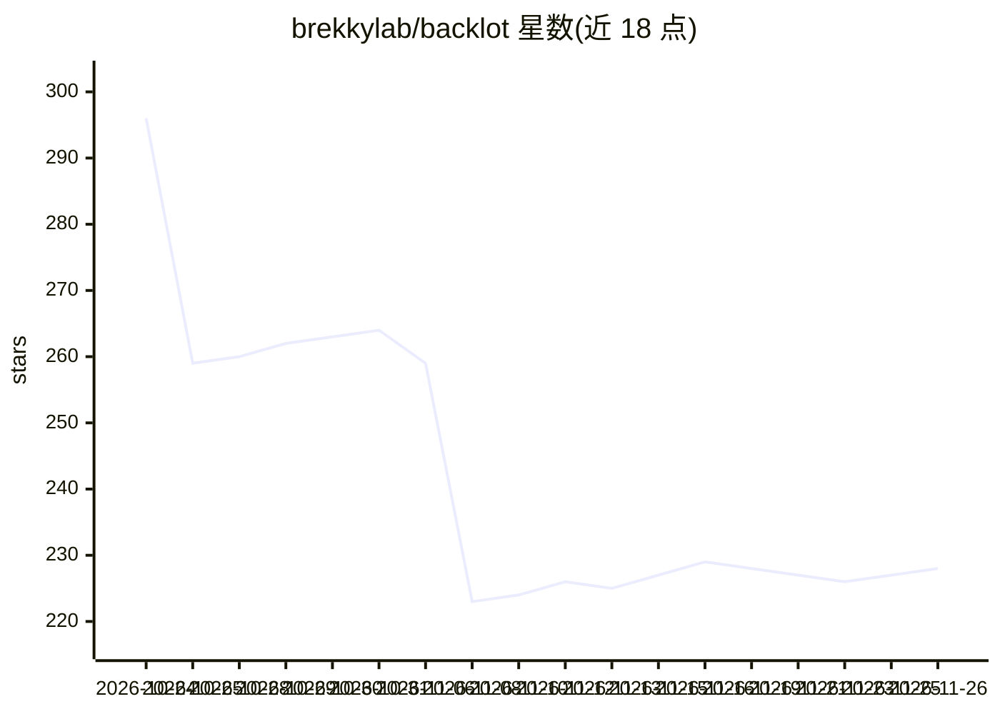

# brekkylab/backlot

⭐ 228 · Python · Apache-2.0 · 推送 2026-11-25 · [GitHub](https://github.com/brekkylab/backlot) · [官网](https://pypi.org/project/backlot) · 个人维护

**本地模拟 Slack/Gmail 等 SaaS API，供集成开发与 agent 测试**

Backlot 在本地运行一个进程，模拟 Slack、Gmail、Google Drive、Microsoft Teams、GitHub、Jira、Notion、S3 等企业 SaaS API 的文档化子集：复现响应结构、分页、认证、错误与按文档 ACL，数据来自用户提供的 JSONL 语料或内置语料，全部读取单一 SQLite 库。使用方式是把官方厂商 SDK 的 base URL 指向本地端口，无需厂商账号、OAuth 审批或网络。支持 write overlay 记录写入并重置语料，提供 MCP 服务器与 agent 插件安装方式。仅模拟各 API 的文档化子集，不覆盖全部厂商端点。

## 筛选速览

| 维度 | 判定 | 备注 |
|---|---|---|
| AI 角色 | `ai-enhanced` | 去掉 AI 部分产品仍成立 |
| 许可风险 | `permissive` | Apache-2.0 |
| 部署形态 | `library` | 以包/库形式分发 |
| 模型依赖 | — | README 未给出锁定关系 |
| 硬件要求 | — | 无带数字的原话,不猜 |
| 安装摩擦 | `low` | 无编译、无系统依赖或容器化 |
| 成熟度 | — | 结构信号不足 |

## 能力要点

- 单进程模拟 12 类 SaaS API，读取同一 SQLite 语料
- 复现分页、认证、错误与按文档 ACL，确定性输出
- write overlay 记录写入行为并可重置语料
- 以 MCP 工具形式提供给 agent，或作为插件安装

## 适用场景

- 在无厂商账号的环境下开发和测试 SaaS 集成
- 用固定语料在 CI 中做可复现的集成测试
- 为 RAG 管线或 agent 评估提供确定性数据源
- 构造无法访问的数据样本来复现解析 bug

## 场景标签

 · 领域:开发工具/API 模拟

## 证据(README 行号)

> L14: Backlot is a local emulator for Slack, Gmail, Google Drive, Microsoft Teams, GitHub, Jira, Notion, S3 and other ent
> L107: - 🤖 **Evaluating a RAG pipeline or an agent**. The same corpus, the same ids and the same answers on every run, so

## 星数曲线

2026-10-24 296 → 2026-11-26 228（-68）

---
*卡片 v1 · prompt 1.4 · 生成 2026-11-25 · 置信度 high · 依据 README sha `c6eef86a060c` · [字段定义](../../DATASET.md)*
