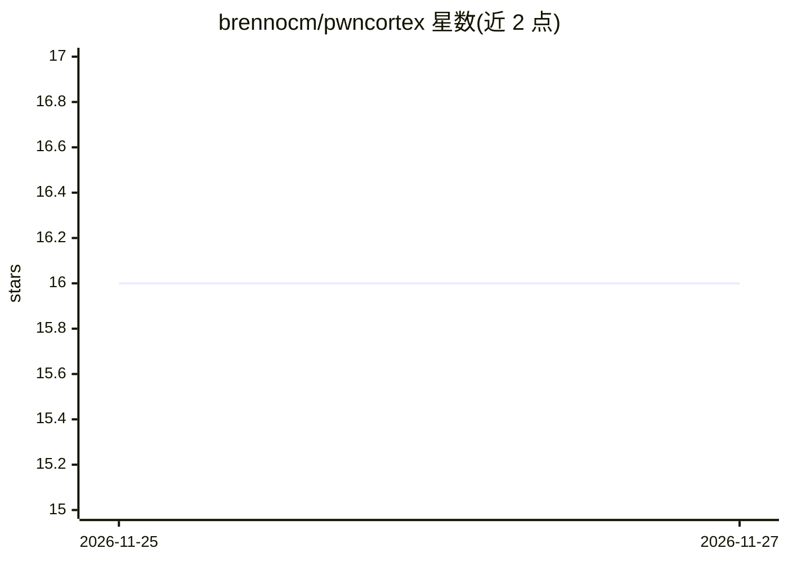

# brennocm/pwncortex

⭐ 16 · Python · AGPL-3.0 · 推送 2026-11-23 · [GitHub](https://github.com/brennocm/pwncortex) · 个人维护

**自托管渗透测试编排平台，AI 上下文辅助**

面向渗透测试人员的自托管平台：导入 Nmap XML/JSON/MD/TXT 扫描结果，自动生成 Cytoscape.js 交互网络拓扑，并用 NVD API 补充 CVE/CVSS 数据。每次 AI 对话以 system prompt 注入全部项目上下文（节点、端口、漏洞、笔记），支持本地 Ollama 与 OpenRouter 两种后端，可在界面运行时切换。笔记遵循 Draft→Verified→Reported 生命周期并同步进执行报告，报告按 CVSS 计算风险评分并可导出 PDF。含 121 项 OWASP WSTG 检查清单。数据存于本地 SQLite，无遥测。仅限授权测试用途，许可证为 AGPL-3.0。

## 筛选速览

| 维度 | 判定 | 备注 |
|---|---|---|
| AI 角色 | `ai-native` | 本体是模型或模型工具 |
| 许可风险 | `viral` | AGPL-3.0 |
| 部署形态 | `self-host` | docker 或自建部署 |
| 模型依赖 | local-ok | 支持本地模型 |
| 硬件要求 | — | 无带数字的原话,不猜 |
| 安装摩擦 | `low` | 无编译、无系统依赖或容器化 |
| 成熟度 | — | 结构信号不足 |

## 能力要点

- AI 聊天自动注入全项目上下文（节点、端口、漏洞、笔记）
- 支持本地 Ollama 与 OpenRouter 双后端，运行时切换
- 扫描导入自动建拓扑并用 NVD/CVSS 补充漏洞数据
- 按 CVSS 生成执行报告，含风险评分卡与修复路线图

## 适用场景

- 在断网/隔离环境中本地运行 AI 辅助的渗透测试项目管理
- 把原始扫描结果整理成交互拓扑并自动补充 CVE 数据
- 从对话与笔记自动汇总生成给客户的执行报告
- 按 OWASP WSTG 121 项清单跟踪测试进度

## 场景标签

`网络安全` · 领域:学习与行业

## 证据(README 行号)

> L9: PwnCortex was built for a real problem of the modern pentester: **keeping all the intelligence of an engagement in o
> L15: - **Context-aware AI chat**: ask about the target in natural language. The LLM receives the full project context (n
> L19: - **Two LLM providers**: use local Ollama (default: `qwen2.5:3b`) for air-gapped engagements, or switch to any Open

## 星数曲线

2026-11-25 16 → 2026-11-27 16（+0）

---
*卡片 v1 · prompt 1.4 · 生成 2026-11-24 · 置信度 high · 依据 README sha `ad9a07dcea8c` · [字段定义](../../DATASET.md)*
