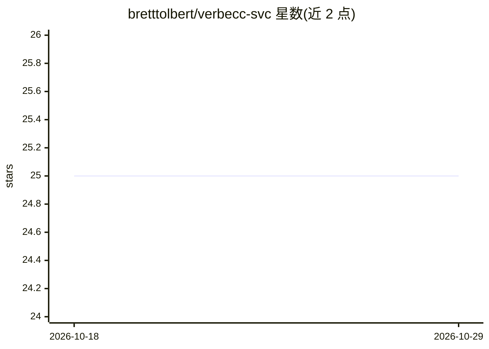

# bretttolbert/verbecc-svc

⭐ 25 · Python · NOASSERTION · 推送 2026-04-21 · [GitHub](https://github.com/bretttolbert/verbecc-svc) · [官网](http://verbe.cc) · 个人维护

**多语种动词变位的 Docker 化 REST 微服务**

基于 Python 与 FastAPI/uvicorn 的 Docker 化微服务，通过 JSON REST API 提供法语、加泰罗尼亚语、西班牙语、意大利语、葡萄牙语和罗马尼亚语的动词变位查询，动词变位能力来自依赖库 verbecc（基于规则模板的变位引擎）。支持按语气、时态过滤结果，提供不定式查找、前缀搜索与变位模板查询等端点，附带单元测试与在线演示，本地通过 docker pull/run 即可启动。

## 筛选速览

| 维度 | 判定 | 备注 |
|---|---|---|
| AI 角色 | `ai-enhanced` | 去掉 AI 部分产品仍成立 |
| 许可风险 | `none` | NOASSERTION |
| 部署形态 | `self-host` | docker 或自建部署 |
| 模型依赖 | — | README 未给出锁定关系 |
| 硬件要求 | — | 无带数字的原话,不猜 |
| 安装摩擦 | `low` | 无编译、无系统依赖或容器化 |
| 成熟度 | — | 结构信号不足 |

## 能力要点

- 覆盖法/加泰/西/意/葡/罗马尼亚 6 种语言的动词变位 REST API
- 支持按 mood 与 tense 参数过滤变位结果（如 indicatif/passé-composé）
- 提供不定式查找、前缀搜索与变位模板查询端点
- Docker 镜像一键部署，自带单元测试

## 适用场景

- 语言学习或翻译应用接入动词变位查询接口
- NLP 流水线中批量获取多语种动词的完整变位表
- 本地部署一个自包含的变位服务避免外部依赖

## 场景标签

 · 领域:自然语言处理/语言学工具

## 证据(README 行号)

> L3: Dockerized microservice with REST API for conjugation of any verb in French, Catalan, Spanish, Italian, Portuguese a
> L12: * Dependencies: verbecc

## 星数曲线

2026-10-18 25 → 2026-10-29 25（+0）

---
*卡片 v1 · prompt 1.4 · 生成 2026-10-27 · 置信度 mid · 依据 README sha `dab2009b4256` · [字段定义](../../DATASET.md)*
