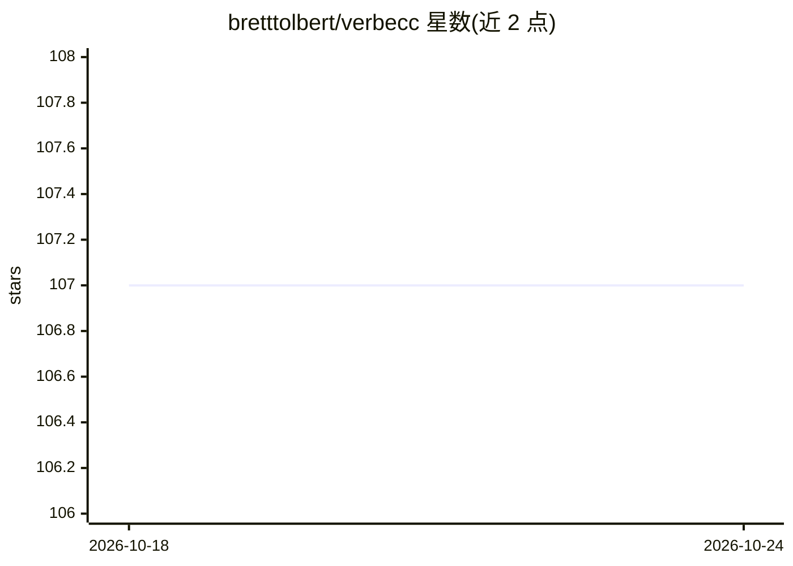

# bretttolbert/verbecc

⭐ 107 · Python · LGPL-3.0 · 推送 2026-09-12 · [GitHub](https://github.com/bretttolbert/verbecc) · [官网](http://verbe.cc) · 个人维护

**罗曼语系动词变位 Python 库，ML 预测未知动词变位**

覆盖法语、西班牙语、加泰罗尼亚语、意大利语、葡萄牙语、罗马尼亚语六种罗曼语的动词完全变位库：已知动词基于 XML 变位模板做字符串变换，未知动词用机器学习（scikit-learn）预测变位模板，自称准确率 99%。输出包含简单与复合变位、地区变体（如西班牙语 voseo、加泰罗尼亚/瓦伦西亚）及全性别代词变格。2.0 版本改为全类型注解并返回包装对象（支持 to_json/to_yaml）。面向 Python 开发者，提供 Web GUI 与 HTTP API 在线演示。

## 筛选速览

| 维度 | 判定 | 备注 |
|---|---|---|
| AI 角色 | `ai-native` | 本体是模型或模型工具 |
| 许可风险 | `viral` | LGPL-3.0 |
| 部署形态 | `library` | 以包/库形式分发 |
| 模型依赖 | — | README 未给出锁定关系 |
| 硬件要求 | — | 无带数字的原话,不猜 |
| 安装摩擦 | `low` | 无编译、无系统依赖或容器化 |
| 成熟度 | — | 结构信号不足 |

## 能力要点

- 六种罗曼语的完全变位（含复合时态与地区变体）
- 未知动词用机器学习预测变位模板（自称 99% 准确率）
- 2.0 全类型注解，返回对象支持 to_json()/to_yaml()
- CI 测试 Python 3.9–3.14

## 适用场景

- 在 Python 应用中生成六种罗曼语的动词变位表
- 语言学或 NLP 项目中对未知动词做变位预测
- 通过 HTTP API 查询动词变位（在线演示）

## 场景标签

 · 领域:计算语言学/NLP

## 证据(README 行号)

> L1: # Python library for verb conjugation in French, Spanish, Catalan, Italian, Portuguese, and Romanian, enhanced by ma
> L35:  * Predict conjugation of unknown verbs with 99% accuracy using machine learning techniques
> L36:  * Conjugate thousands of known verbs without machine learning, using simple string transformations based on XML co

## 星数曲线

2026-10-18 107 → 2026-10-24 107（+0）

---
*卡片 v1 · prompt 1.4 · 生成 2026-10-23 · 置信度 mid · 依据 README sha `1c89a1957460` · [字段定义](../../DATASET.md)*
