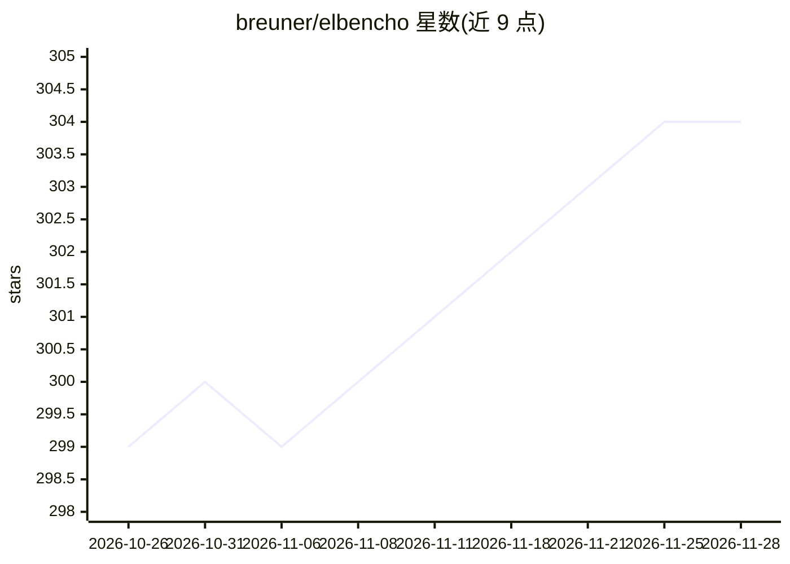

# breuner/elbencho

⭐ 304 · C++ · GPL-3.0 · 推送 2026-11-27 · [GitHub](https://github.com/breuner/elbencho) · 个人维护

**面向文件/对象/块存储与 GPU 的分布式基准测试工具**

统一测量文件系统、对象存储与块设备的延迟、吞吐与 IOPS，支持本地与共享存储的分布式服务模式，通过 TCP/RDMA 做 N-to-M 网络测试，并提供实时统计、数据完整性校验、CSV/JSON 结果输出与配套图表工具（elbencho-chart、elbencho-summarize-json）。GPU 路径支持 Nvidia CUDA/GPUDirect Storage 与 AMD HIP/hipFile；面向运行 NVMe 存储或深度学习负载的存储管理员与 HPC 用户。从源码构建或使用 Releases/Docker Hub 预构建包。

## 筛选速览

| 维度 | 判定 | 备注 |
|---|---|---|
| AI 角色 | `ai-ecosystem` | LLM/agent 周边工具 |
| 许可风险 | `viral` | GPL-3.0 |
| 部署形态 | `desktop` | 安装包/桌面程序 |
| 模型依赖 | — | README 未给出锁定关系 |
| 硬件要求 | — | 无带数字的原话,不猜 |
| 安装摩擦 | `high` | 编译与系统依赖俱全 |
| 成熟度 | — | 结构信号不足 |

## 能力要点

- 统一基准覆盖文件、对象（S3）与块存储三种模式
- 分布式服务模式支持多客户端对共享存储的测试
- GPU 存储访问测试：Nvidia CUDA/GDS 与 AMD HIP/hipFile
- 内置 N-to-M 网络基准（TCP、ibverbs、rdmacm、libfabric 引擎）

## 适用场景

- 测试 NVMe 共享文件系统在多客户端下的吞吐与 IOPS
- 为深度学习训练评估 GPU Direct Storage 读取性能
- 对 S3 对象存储做延迟与吞吐基准
- 通过 MPI 模式在 Slurm/K8s 集群上运行分布式测试

## 场景标签

 · 领域:系统工具/存储性能测试

## 证据(README 行号)

> L16: * GPU storage access performance testing through Nvidia CUDA / GPUDirect Storage (GDS) or AMD HIP / hipFile
> L96: If GPU data transfer performance is critical for you, e.g. because you are running DeepLearning applications, you w

## 星数曲线

2026-10-26 299 → 2026-11-28 304（+5）

---
*卡片 v1 · prompt 1.4 · 生成 2026-11-28 · 置信度 mid · 依据 README sha `117cf73021d4` · [字段定义](../../DATASET.md)*
