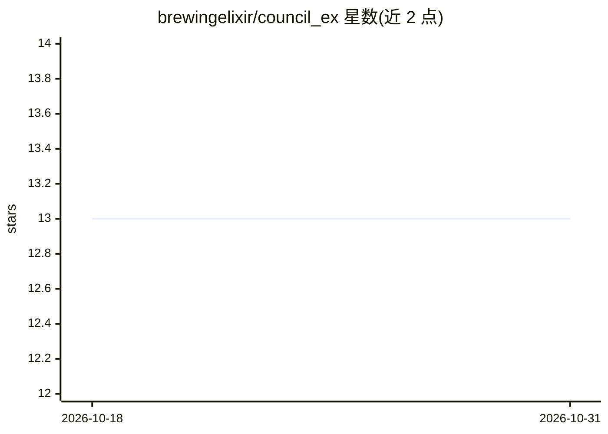

# brewingelixir/council_ex

⭐ 13 · Elixir · Apache-2.0 · 推送 2026-05-31 · [GitHub](https://github.com/brewingelixir/council_ex) · 个人维护

**Elixir 多模型 LLM 议会编排框架：辩论/投票/合成**

面向 Elixir 开发者的多模型 LLM 议会（council）编排框架：以 DSL 或动态数据结构定义成员议会，运行独立分析、同行评审、投票、两两淘汰等轮次并合成最终答案。内置 OpenAI、Anthropic、Gemini、OpenRouter 适配器，Ollama 以 OpenAI 适配器之上的配置预设提供。另含置信度触发重试、可靠性加权共识、工具调用、流式输出、Telemetry/PubSub 可观测性等机制。核心零额外依赖，各后端（Ecto/Oban/Redis/Phoenix.PubSub）以可选依赖声明，未用不安装。灵感来自 karpathy/llm-council。

## 筛选速览

| 维度 | 判定 | 备注 |
|---|---|---|
| AI 角色 | `ai-ecosystem` | LLM/agent 周边工具 |
| 许可风险 | `permissive` | Apache-2.0 |
| 部署形态 | `None` |  |
| 模型依赖 | local-ok | 支持本地模型 |
| 硬件要求 | — | 无带数字的原话,不猜 |
| 安装摩擦 | `low` | 无编译、无系统依赖或容器化 |
| 成熟度 | — | 结构信号不足 |

## 能力要点

- 静态 DSL 与动态数据结构两种议会定义形式，同一条执行路径
- 内置 OpenAI/Anthropic/Gemini/OpenRouter 适配器，Ollama 为配置预设
- 预置 Specialist/Consensus/Tournament/WeightedConsensus/JuryWithRetry 等议会模式
- 核心库零额外依赖，持久化/后台任务等后端均为可选依赖

## 适用场景

- 让多个模型并行分析并投票合成，替代单模型调用
- 搭建同行评审、辩论、锦标赛式的多模型决策流程
- 为 Elixir 应用接入多家 LLM 提供商并统一观测运行过程

## 场景标签

`多智能体` `Agent 框架` · 领域:Agent 开发

## 证据(README 行号)

> L3: Multi-model LLM council workflows for Elixir.
> L23: - 🔌 **Multi-provider adapters**: OpenAI, Anthropic, Gemini, and OpenRouter implement the `CouncilEx.Provider.Adapte

## 星数曲线

2026-10-18 13 → 2026-10-31 13（+0）

---
*卡片 v1 · prompt 1.4 · 生成 2026-10-31 · 置信度 high · 依据 README sha `fbf1c11dc32e` · [字段定义](../../DATASET.md)*
