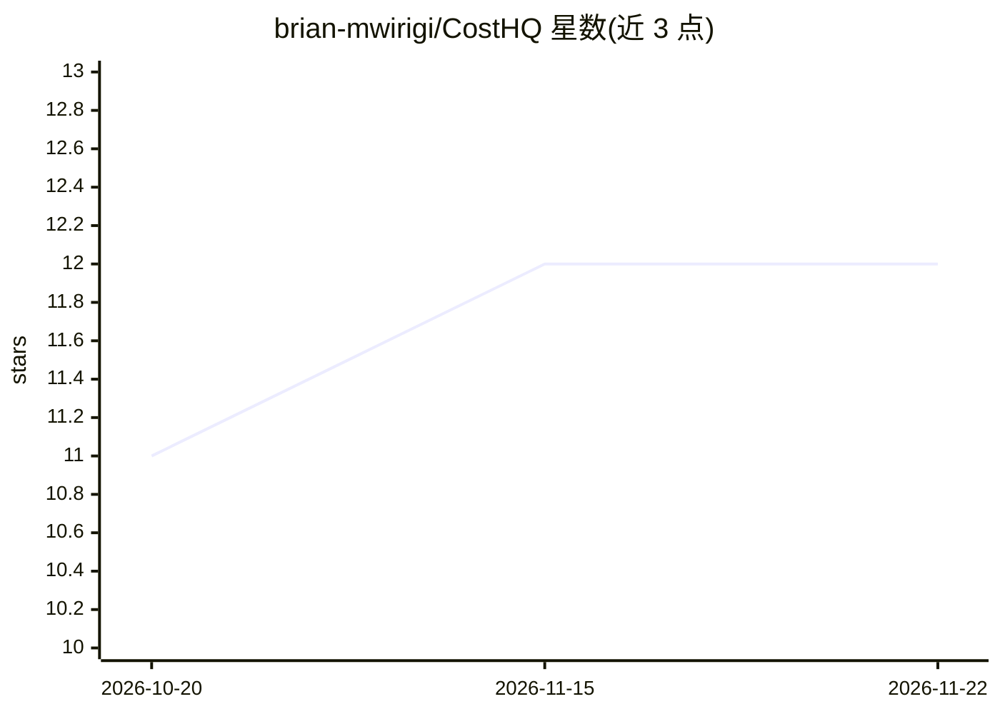

# brian-mwirigi/CostHQ

⭐ 12 · HTML · MIT · 推送 2026-06-10 · [GitHub](https://github.com/brian-mwirigi/CostHQ) · [官网](https://www.npmjs.com/package/costhq) · 个人维护

**为 AI agent 提供成本追踪与硬预算熔断的 CLI/面板/API**

面向运行 AI agent 的开发者的成本管理工具：实时记录每次 API 调用的 token 与费用，按用户/会话/项目设置硬性美元预算，超限时通过 BudgetExceededError 中断请求。提供 CLI（cs 命令族，支持 --json）、本地 Web 仪表盘（localhost:3737）与程序化 API；自动追踪文件与 git 提交，内置模型定价表与自定义覆盖。本地嵌入 SQLite 存储，仪表盘默认仅绑定 127.0.0.1，不发送遥测。Free 版限 1 个本地项目，Pro 版解锁语义缓存代理、团队预算等。

## 筛选速览

| 维度 | 判定 | 备注 |
|---|---|---|
| AI 角色 | `ai-ecosystem` | LLM/agent 周边工具 |
| 许可风险 | `permissive` | MIT |
| 部署形态 | `library` | 以包/库形式分发 |
| 模型依赖 | local-ok | 支持本地模型 |
| 硬件要求 | — | 无带数字的原话,不猜 |
| 安装摩擦 | `medium` | 含编译或系统依赖之一 |
| 成熟度 | — | 结构信号不足 |

## 能力要点

- 主动熔断：超预算即抛 BudgetExceededError 终止循环
- 语义缓存代理对重复查询本地返回，不计 API 费用（Pro）
- CLI 全命令支持 --json，自动追踪文件与 git 提交
- 本地仪表盘含模型/提供商成本拆解、告警与导出（JSON/CSV）

## 适用场景

- 为自主运行的 coding agent 会话记录 API 花费与文件/提交
- 按用户或项目设置硬预算，防止 agent 死循环烧钱
- 对比本地模型（Ollama/vLLM/llama.cpp）与云端的硬件成本
- 导出会话与 token 数据做成本分析

## 场景标签

`LLM 可观测性` · 领域:评测与运维

## 证据(README 行号)

> L31: **CostHQ is your Margin Firewall.** We don't just track exact API costs in real-time—we actively enforce them. Set 
> L70: - **Custom agents** — Programmatic API with budget enforcement
> L96: We've made it irresistibly easy to get cost data in any common AI workflow. CostHQ acts as your unified platform fo

## 星数曲线

2026-10-20 11 → 2026-11-22 12（+1）

---
*卡片 v1 · prompt 1.4 · 生成 2026-11-18 · 置信度 high · 依据 README sha `18617a8e2a08` · [字段定义](../../DATASET.md)*
