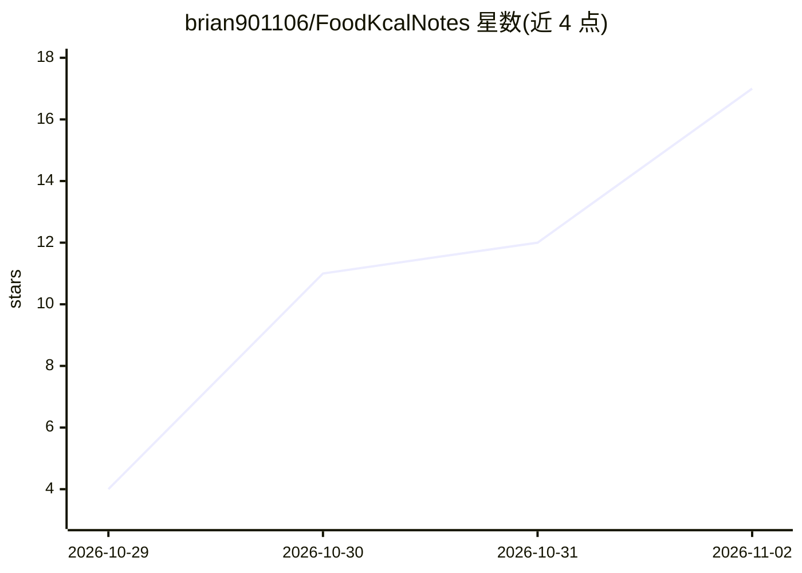

# brian901106/FoodKcalNotes

⭐ 17 · JavaScript · MIT · 推送 2026-10-28 · [GitHub](https://github.com/brian901106/FoodKcalNotes) · 个人维护 · 中文 README

**本机自架的饮食热量日志 App：AI 识别食物与份量，热量来自可核对来源**

在自己电脑上运行的繁体中文饮食热量日志（PWA；Express + node:sqlite + React/Vite），针对台湾常见食物设计。用户拍照或打字，LLM 辨识食物品名与份量并输出结构化数据，但热量不由模型给出，而是按包装营养标示→本机食物库→网络搜寻（须有可核对引用）→LLM 估算的顺序取数，由程序计算重量×每100g热量。支持 ChatGPT 账号 OAuth 登录与 Claude API key 两种 AI 服务并可自动备援。需 Node.js 24 以上，通过 Tailscale serve 从手机访问；维护者声明为个人项目、不保证持续维护。

## 筛选速览

| 维度 | 判定 | 备注 |
|---|---|---|
| AI 角色 | `ai-native` | 本体是模型或模型工具 |
| 许可风险 | `permissive` | MIT |
| 部署形态 | `desktop` | 安装包/桌面程序 |
| 模型依赖 | locked-api |  |
| 硬件要求 | — | 无带数字的原话,不猜 |
| 安装摩擦 | `low` | 无编译、无系统依赖或容器化 |
| 成熟度 | — | 结构信号不足 |

## 能力要点

- LLM 只负责识别品名与份量，热量一律取自可核对来源并由程序计算
- 保存餐点时自动将网络资料与营养标示缓存进本机食物库，命中后不再调用模型
- ChatGPT OAuth 登录与 Claude API key 可同时设定并按顺序自动备援
- 内附食药署 137 笔、国健署 22 笔台湾在地营养数据，支持自行导入

## 适用场景

- 拍照或打字记录三餐并追踪每日热量与减重计划
- 记录台湾早餐、小吃等在地食物的热量
- 通过 Tailscale 在手机上使用电脑端同一本日志

## 场景标签

`目标检测` · 领域:感知与多模态

## 证据(README 行号)

> L5: 在自己電腦上執行的繁體中文飲食熱量日誌（PWA；Express + `node:sqlite` + React/Vite），針對台灣常見食物與份量設計。手機拍照或打字，AI 辨識食物與份量，熱量優先取自本機食物庫與可核對的來源，最後
> L50: - **熱量來源**：包裝營養標示 → 本機食物庫 → 網路搜尋（須有可核對的引用）→ LLM 估算，每項都標示來源。熱量＝重量 × 每100g熱量 ÷ 100，由程式計算，不由模型給。

## 星数曲线

2026-10-29 4 → 2026-11-02 17（+13）

---
*卡片 v1 · prompt 1.4 · 生成 2026-11-01 · 置信度 high · 依据 README sha `ed9649639c05` · [字段定义](../../DATASET.md)*
