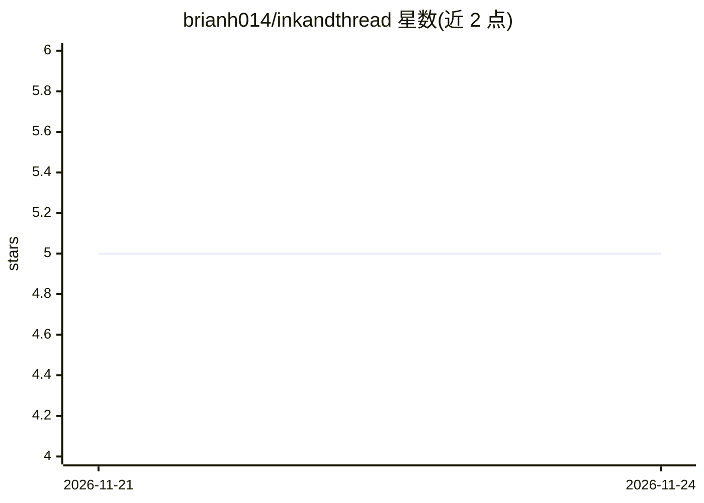

# brianh014/inkandthread

⭐ 5 · TypeScript · AGPL-3.0 · 推送 2026-11-22 · [GitHub](https://github.com/brianh014/inkandthread) · 个人维护

**单玩家 AI 视觉小说游戏：边玩边生成剧情与插画**

Ink & Thread 是一个在本地运行的单人故事游戏，玩法类似选择冒险书：玩家构建世界与角色后只扮演自己的人物，AI 担任叙事者，秘密维持隐藏的剧情线、扮演其他角色、以隐藏骰子决定行动成败，并将故事保存为结构化状态（人物认知、悬而未决线索、时间与旧记忆），可在 Journal 中查看编辑。每条消息保留完整快照，支持回退、重写与分支。文本图像分别通过用户自备的 API 生成，需自行接入 API key。提供 Windows/macOS/Linux 安装包及无头 Server 版本。

## 筛选速览

| 维度 | 判定 | 备注 |
|---|---|---|
| AI 角色 | `ai-native` | 本体是模型或模型工具 |
| 许可风险 | `none` | AGPL-3.0 |
| 部署形态 | `desktop` | 安装包/桌面程序 |
| 模型依赖 | — | README 未给出锁定关系 |
| 硬件要求 | — | 无带数字的原话,不猜 |
| 安装摩擦 | `low` | 无编译、无系统依赖或容器化 |
| 成熟度 | — | 结构信号不足 |

## 能力要点

- 叙事者机制：隐藏剧情线、秘密策划与其他角色扮演，不为玩家角色代言
- 结构化故事状态而非纯聊天记录：Loose Ends、Journal 可读可编辑
- 每条消息保留完整快照，可回退、分支与重来
- 支持切换文本模型与图像来源（OpenRouter、本地 ComfyUI 等）

## 适用场景

- 像玩选择冒险游戏那样体验 AI 生成剧情的视觉小说
- 在本地用 ComfyUI 生成插画以保持内容不出本机
- 长篇角色扮演故事中随时回溯、分支尝试不同选择

## 场景标签

`图像生成` · 领域:内容生成

## 证据(README 行号)

> L5:  A choose-your-own visual novel, written as you play.
> L7: Ink & Thread is a single-player story game, played like a Telltale game or a choose-your-own-adventure book. You bui
> L9: It runs on your own computer and talks to models you choose. Bring an OpenAI-compatible text API (OpenRouter, DeepIn

## 星数曲线

2026-11-21 5 → 2026-11-24 5（+0）

---
*卡片 v1 · prompt 1.4 · 生成 2026-11-21 · 置信度 high · 依据 README sha `f08a7e10d347` · [字段定义](../../DATASET.md)*
