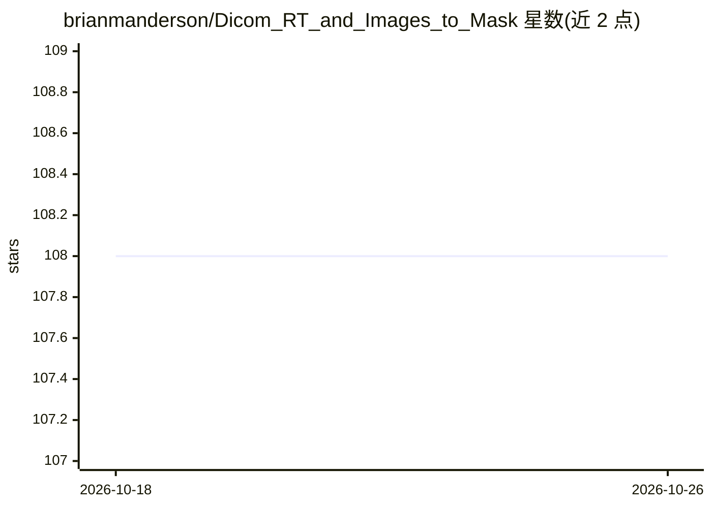

# brianmanderson/Dicom_RT_and_Images_to_Mask

⭐ 108 · Python · GPL-3.0 · 推送 2026-09-08 · [GitHub](https://github.com/brianmanderson/Dicom_RT_and_Images_to_Mask) · 个人维护

**面向研究者的 DICOM/RT 结构转 NIfTI/NumPy 转换库**

Python 库，将 DICOM 图像序列、RT 结构集与剂量文件转换为 NumPy 数组、NIfTI 文件和 SimpleITK 句柄，供研究与模型开发使用；也可将模型预测掩膜写回 RT 结构集。工作流为发现→普查→选择→导出：递归扫描目录、生成含 ROI 体积与剂量 Dmax 的 manifest、ROI 别名映射、体素重采样导出，支持匿名化（SHA-256 确定性哈希）。声明非临床认证器械，临床相关使用需本地验证并仅限打标签的发布版本。提供 pip 安装，支持 Python 3.10-3.13。

## 筛选速览

| 维度 | 判定 | 备注 |
|---|---|---|
| AI 角色 | `ai-ecosystem` | LLM/agent 周边工具 |
| 许可风险 | `viral` | GPL-3.0 |
| 部署形态 | `library` | 以包/库形式分发 |
| 模型依赖 | — | README 未给出锁定关系 |
| 硬件要求 | — | 无带数字的原话,不猜 |
| 安装摩擦 | `low` | 无编译、无系统依赖或容器化 |
| 成熟度 | — | 结构信号不足 |

## 能力要点

- DICOM 图像/RT 结构/剂量 → NIfTI、NumPy、SimpleITK 转换
- 预测掩膜写回 RT 结构集（prediction_array_to_RT）
- 含 ROI 体积与剂量 Dmax 的增量式 manifest 与匿名化导出
- 图像/掩膜/剂量统一网格的体素重采样

## 适用场景

- 把放射治疗 DICOM 数据整理为可训练的 NIfTI 数据集
- 普查和索引 DICOM 语料库的 ROI 与剂量信息
- 把分割模型的预测结果写回 RT 结构集供放疗流程审查

## 场景标签

`图像视频处理` · 领域:感知与多模态

## 证据(README 行号)

> L19: **What it is for:** converting DICOM image series and RT structure sets into
> L20: arrays, NIfTI, and SimpleITK handles for research and model development;

## 星数曲线

2026-10-18 108 → 2026-10-26 108（+0）

---
*卡片 v1 · prompt 1.4 · 生成 2026-10-23 · 置信度 high · 依据 README sha `f823164ae0a9` · [字段定义](../../DATASET.md)*
