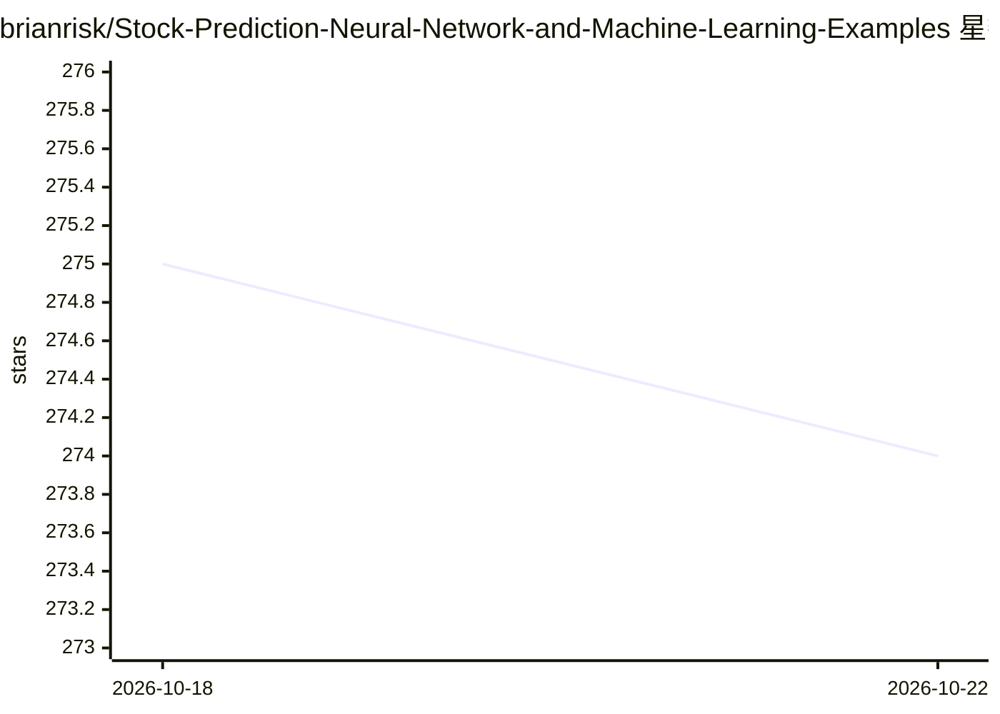

# brianrisk/Stock-Prediction-Neural-Network-and-Machine-Learning-Examples

⭐ 274 · Python · Apache-2.0 · 推送 2026-07-24 · [GitHub](https://github.com/brianrisk/Stock-Prediction-Neural-Network-and-Machine-Learning-Examples) · [官网](https://d.at/ref/github-python-examples) · 个人维护

**机器学习与神经网络股价预测的 Python 教学示例集合**

收录多个小型可运行的股价分类示例：6 种机器学习方法（遗传算法、梯度提升、K-means、逻辑回归、随机森林、SVM）与 3 种神经网络结构（FFNN、LSTM、RNN），使用 Keras、PyTorch、PyTorch Lightning、TensorFlow 实现。附带 D.AT 五年标普 500 数据集及 CSV 格式说明，另提供网格/随机超参搜索工具。README 明确声明仅供教学演示，非投资建议，未考虑滑点、流动性、税费等交易因素。

## 筛选速览

| 维度 | 判定 | 备注 |
|---|---|---|
| AI 角色 | `ai-native` | 本体是模型或模型工具 |
| 许可风险 | `permissive` | Apache-2.0 |
| 部署形态 | `library` | 以包/库形式分发 |
| 模型依赖 | — | README 未给出锁定关系 |
| 硬件要求 | — | 无带数字的原话,不猜 |
| 安装摩擦 | `low` | 无编译、无系统依赖或容器化 |
| 成熟度 | — | 结构信号不足 |

## 能力要点

- 6 种机器学习与 3 种神经网络结构的可运行示例
- 使用 Keras/PyTorch/PyTorch Lightning/TensorFlow 实现
- 支持网格与随机超参搜索（多进程评估）
- 附带五年标普 500 示例数据集与防泄漏说明（EMBARGO_ROWS）

## 适用场景

- 学习各类 ML/NN 方法在股价分类上的实现
- 练习数据加载、训练、评估与按预测分数排序的流程
- 了解时间序列数据划分与信息泄漏防范做法

## 场景标签

 · 领域:金融/机器学习

## 证据(README 行号)

> L11: This repository contains small, runnable machine learning (ML) and neural
> L35: The neural network examples use Keras, PyTorch, PyTorch Lightning, and

## 星数曲线

2026-10-18 275 → 2026-10-22 274（-1）

---
*卡片 v1 · prompt 1.4 · 生成 2026-10-22 · 置信度 high · 依据 README sha `9c6f2ff66523` · [字段定义](../../DATASET.md)*
