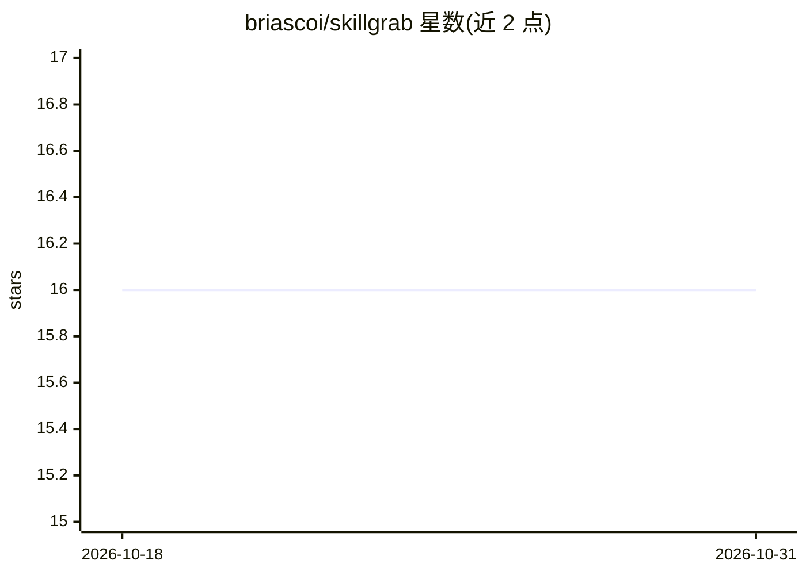

# briascoi/skillgrab

⭐ 16 · HTML · MIT · 推送 2026-04-21 · [GitHub](https://github.com/briascoi/skillgrab) · [官网](https://briascoi.github.io/skillgrab/) · 个人维护

**一条命令扫描项目并自动安装匹配 AI agent 技能的 CLI**

通过 npx 运行的 Node.js CLI 工具：读取项目的 package.json、requirements.txt、Dockerfile 与 README，检测 JavaScript/Python/移动端/后端/基础设施及营销等非代码需求，从 skills.sh 注册表（9 万+ 技能）按信任度与热度排序、经 GitHub 校验后安装匹配的 AI agent 技能。自动探测 ~/.claude、~/.cursor 等配置目录，一次性安装到 Claude Code、Cursor、Cline 等 40+ agent；提供 status/update 子命令、--dry-run 与 --only-trusted 安全选项，并可作为 MCP server 被聊天中的 agent 调用。

## 筛选速览

| 维度 | 判定 | 备注 |
|---|---|---|
| AI 角色 | `ai-ecosystem` | LLM/agent 周边工具 |
| 许可风险 | `permissive` | MIT |
| 部署形态 | `self-host` | docker 或自建部署 |
| 模型依赖 | — | README 未给出锁定关系 |
| 硬件要求 | — | 无带数字的原话,不猜 |
| 安装摩擦 | `low` | 无编译、无系统依赖或容器化 |
| 成熟度 | — | 结构信号不足 |

## 能力要点

- 扫描项目依赖与 README，自动推荐并安装 skills.sh 技能
- 自动探测并一次安装到多个 agent（Claude Code、Cursor、Cline、Codex 等 40+）
- 信任所有者加权排序、GitHub 存在性校验、--only-trusted 白名单模式
- 可作为 MCP server 暴露 recommend/install/status 三个工具

## 适用场景

- 为现有项目一键补齐匹配技术栈的 agent 技能
- 统一查看与更新已安装到各 agent 的技能
- 在 Claude Desktop / Cursor 聊天中直接调用技能推荐与安装

## 场景标签

 · 领域:开发者工具/AI agent 生态

## 证据(README 行号)

> L16: skillgrab scans your project, detects your stack — frontend, backend, mobile, infra, marketing — and installs the r
> L79: skillgrab auto-detects installed agents by probing their config dirs (`~/.claude`, `~/.cursor`, `~/.cline`, etc.) a
> L156: skillgrab exposes itself as an MCP server so Claude Desktop, Cursor, Cline, and other MCP-compatible agents can in

## 星数曲线

2026-10-18 16 → 2026-10-31 16（+0）

---
*卡片 v1 · prompt 1.4 · 生成 2026-10-30 · 置信度 mid · 依据 README sha `f46710224d61` · [字段定义](../../DATASET.md)*
