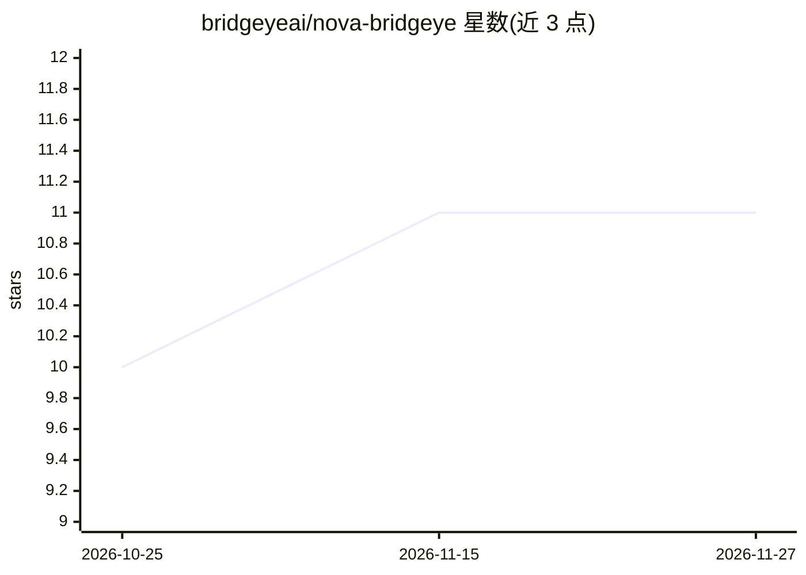

# bridgeyeai/nova-bridgeye

⭐ 11 · NOASSERTION · 推送 2026-11-25 · [GitHub](https://github.com/bridgeyeai/nova-bridgeye) · [官网](https://nova.bridgeye.com/) · 组织维护

**终端里的自主修复型开发 agent：自动修复报错与环境问题**

nova 是运行在终端中的 CLI agent，面向开发者的开发流程自动化：用 run 命令执行任意脚本，崩溃时分析 traceback、定位本地文件并自动打补丁，检测 ImportError 后在当前环境安装缺失依赖并重跑任务；它还读取目录结构以执行准确的文件操作。文件修改与包安装均需用户明确授权。安装要求 Python 3.10+，经 pip 分发，启动后需登录认证，由 Bridgeye Pvt Ltd 维护。

## 筛选速览

| 维度 | 判定 | 备注 |
|---|---|---|
| AI 角色 | `ai-ecosystem` | LLM/agent 周边工具 |
| 许可风险 | `none` | NOASSERTION |
| 部署形态 | `library` | 以包/库形式分发 |
| 模型依赖 | — | README 未给出锁定关系 |
| 硬件要求 | — | 无带数字的原话,不猜 |
| 安装摩擦 | `low` | 无编译、无系统依赖或容器化 |
| 成熟度 | — | 结构信号不足 |

## 能力要点

- 崩溃时分析 traceback 并自动应用 Surgical Edit 修复
- 检测 ImportError 并在当前环境自动安装缺失依赖
- 路径感知：映射本地目录结构以执行文件操作
- 文件变更与包安装需用户显式授权

## 适用场景

- 脚本运行崩溃后让 agent 自动定位并修复代码
- 缺少依赖库时自动安装并重跑任务
- 在终端中让 agent 按描述规划并生成项目代码

## 场景标签

`编码 Agent` `代码生成` · 领域:编码与开发

## 证据(README 行号)

> L5: **nova** is an autonomous junior developer that lives in your terminal. It plans, executes, and — most importantly —
> L11: - **Self-Healing Execution:** Run any script with `run`. If it crashes, **nova** analyzes the traceback, finds the 
> L15: ## **Installation**

## 星数曲线

2026-10-25 10 → 2026-11-27 11（+1）

---
*卡片 v1 · prompt 1.4 · 生成 2026-11-18 · 置信度 high · 依据 README sha `09974bda4870` · [字段定义](../../DATASET.md)*
