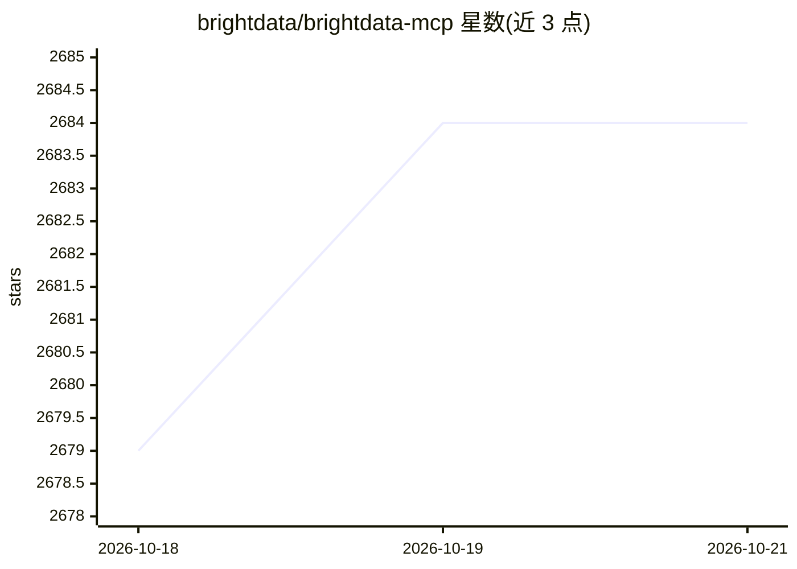

# brightdata/brightdata-mcp

⭐ — · [GitHub]() · 组织维护

**为 AI 代理提供公开网络访问的 MCP 服务器（32 个工具）**

Bright Data 公司维护的 MCP 服务器，向 AI 代理和 LLM 提供实时公开网络数据访问：网页搜索（Google/Bing/Yandex）、页面抓取为 Markdown/HTML、1,200+ 预建结构化抓取器（Amazon、LinkedIn、TikTok、npm、PyPI 等）、14 个远程浏览器自动化工具，以及收集 ChatGPT/Perplexity 回答的工具。所有请求经 Bright Data 反封锁基础设施处理（验证码、代理轮换）。支持托管远程服务器（一个 URL）或本地 npx 运行，每月 5,000 次免费请求，超出按量计费。

## 筛选速览

| 维度 | 判定 | 备注 |
|---|---|---|
| AI 角色 | `ai-ecosystem` | LLM/agent 周边工具 |
| 许可风险 | `permissive` | — |
| 部署形态 | `desktop` | 安装包/桌面程序 |
| 模型依赖 | — | README 未给出锁定关系 |
| 硬件要求 | — | 无带数字的原话,不猜 |
| 安装摩擦 | `low` | 无编译、无系统依赖或容器化 |
| 成熟度 | — | 结构信号不足 |

## 能力要点

- 32 个工具：搜索、抓取、结构化提取、浏览器自动化、LLM 回答收集
- 1,200+ 预建抓取器输出结构化 JSON，无需解析 HTML
- 每次请求内置反爬处理（验证码、代理轮换、地理定位）
- 托管远程服务器或本地 npx 两种部署方式，工具可按组裁剪

## 适用场景

- 让 AI 代理查询实时网络信息替代训练数据
- 抓取电商、社交媒体等受保护站点的结构化数据
- 编程代理按需查询 npm/PyPI 包信息
- 对比不同 LLM 如何描述品牌以做生成引擎优化

## 场景标签

`浏览器自动化` `网页抓取` · 领域:效率与自动化

## 证据(README 行号)

> L7:  Web search, page scraping, structured data extraction, and browser automation for AI agents and LLMs over the Model
> L26: The Bright Data MCP server gives AI agents real-time access to public web data. It exposes **32 tools** covering:
> L36: Two deployment options: a hosted remote server (one URL, no installation) or a local instance via `npx @brightdata/

## 星数曲线

2026-10-18 2,679 → 2026-10-21 2,684（+5）

---
*卡片 v1 · prompt 1.4 · 生成 2026-10-21 · 置信度 mid · 依据 README sha `68da7d26f734` · [字段定义](../../DATASET.md)*
