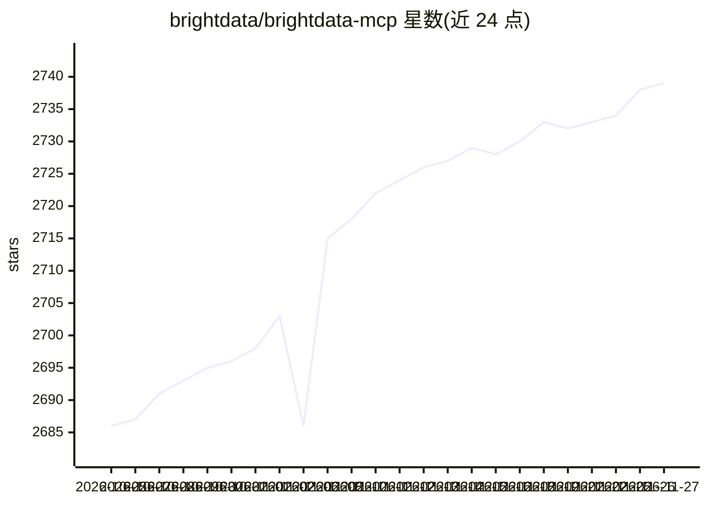

# brightdata/brightdata-mcp

⭐ 2,739 · JavaScript · MIT · 推送 2026-11-26 · [GitHub](https://github.com/brightdata/brightdata-mcp) · [官网](https://brightdata.com/) · 组织维护

**为 AI 代理提供网页搜索、抓取与浏览器自动化的 MCP 服务器**

Bright Data 的 MCP 服务器，向 AI 代理与 LLM 客户端暴露 30 余个工具：Bing/Google 搜索返回结构化数据、任意 URL 转 Markdown/HTML/JSON-LD、1,200+ 预建爬虫输出平台结构化 JSON、远程浏览器会话内点击输入截图、向 ChatGPT 发送 prompt 收集回答。支持托管远程服务器（URL 接入）与本地 npx 实例两种部署；工具按分组加载以减少上下文占用。含每月 5,000 次免费额度，超出后按量计费。

## 筛选速览

| 维度 | 判定 | 备注 |
|---|---|---|
| AI 角色 | `ai-ecosystem` | LLM/agent 周边工具 |
| 许可风险 | `permissive` | MIT |
| 部署形态 | `desktop` | 安装包/桌面程序 |
| 模型依赖 | — | README 未给出锁定关系 |
| 硬件要求 | — | 无带数字的原话,不猜 |
| 安装摩擦 | `low` | 无编译、无系统依赖或容器化 |
| 成熟度 | — | 结构信号不足 |

## 能力要点

- 30 个 MCP 工具：搜索、网页抓取、结构化数据、浏览器自动化
- 1,200+ 预建爬虫覆盖 Amazon/LinkedIn/TikTok/YouTube 等平台
- 托管远程 URL 与本地 npx 两种部署方式
- 工具分组（GROUPS/TOOLS）按需加载以控制上下文

## 适用场景

- 让 AI 代理用实时网页数据回答问题而非依赖训练数据
- 电商比价与商品评论的结构化采集
- 为编程代理按需获取 npm/PyPI 包与 GitHub 仓库数据
- 监控社交平台账号的帖子与互动数据

## 场景标签

`浏览器自动化` `网页抓取` · 领域:效率与自动化

## 证据(README 行号)

> L7:  Web search, page scraping, structured data extraction, and browser automation for AI agents and LLMs over the Model
> L26: The Bright Data MCP server gives AI agents real-time access to public web data. It exposes **30 tools** covering:
> L35: Two deployment options: a hosted remote server (one URL, no installation) or a local instance via `npx @brightdata/

## 星数曲线

2026-10-25 2,686 → 2026-11-27 2,739（+53）

---
*卡片 v1 · prompt 1.4 · 生成 2026-11-27 · 置信度 mid · 依据 README sha `b21b98bb92af` · [字段定义](../../DATASET.md)*
