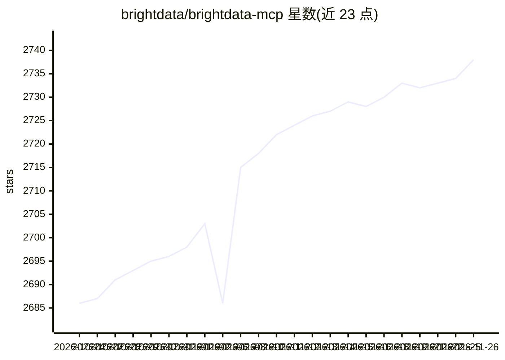

# brightdata/brightdata-mcp

⭐ 2,738 · JavaScript · MIT · 推送 2026-11-24 · [GitHub](https://github.com/brightdata/brightdata-mcp) · [官网](https://brightdata.com/) · 组织维护

**给 AI 代理提供网页搜索、抓取与浏览器自动化的 MCP 服务器**

Bright Data 出品的 MCP 服务器，向 AI 代理与 MCP 兼容客户端提供 31 个工具：网页搜索（Bing/Google 结果结构化）、任意 URL 转 Markdown/HTML/JSON-LD、1,200+ 预构建爬虫的结构化 JSON 输出、远程浏览器自动化，以及收集 ChatGPT/Perplexity 回答。支持托管远程服务器（URL 接入、免安装）与本地 npx 两种部署方式，可通过 GROUPS/TOOLS 参数按需加载工具组。每月免费 5,000 请求，超出后按量计费。

## 筛选速览

| 维度 | 判定 | 备注 |
|---|---|---|
| AI 角色 | `ai-ecosystem` | LLM/agent 周边工具 |
| 许可风险 | `permissive` | MIT |
| 部署形态 | `desktop` | 安装包/桌面程序 |
| 模型依赖 | — | README 未给出锁定关系 |
| 硬件要求 | — | 无带数字的原话,不猜 |
| 安装摩擦 | `low` | 无编译、无系统依赖或容器化 |
| 成熟度 | — | 结构信号不足 |

## 能力要点

- 31 个工具覆盖搜索、抓取、结构化数据、浏览器自动化
- 1,200+ 预构建爬虫输出干净 JSON，覆盖 Amazon、LinkedIn、TikTok 等
- 托管远程（一个 URL）与本地 npx 两种部署方式
- 工具分组机制（GROUPS/TOOLS）减少代理上下文占用

## 适用场景

- 让 AI 代理用实时网页数据回答问题而非仅依赖训练数据
- 电商比价与产品数据结构化采集
- 为编码代理按需获取 npm/PyPI/GitHub 包信息
- 社交平台账号与帖子的结构化监控

## 场景标签

`浏览器自动化` `网页抓取` · 领域:效率与自动化

## 证据(README 行号)

> L7:  Web search, page scraping, structured data extraction, and browser automation for AI agents and LLMs over the Model
> L26: The Bright Data MCP server gives AI agents real-time access to public web data. It exposes **31 tools** covering:
> L35: Two deployment options: a hosted remote server (one URL, no installation) or a local instance via `npx @brightdata/

## 星数曲线

2026-10-24 2,686 → 2026-11-26 2,738（+52）

---
*卡片 v1 · prompt 1.4 · 生成 2026-11-26 · 置信度 mid · 依据 README sha `a7df49905a81` · [字段定义](../../DATASET.md)*
