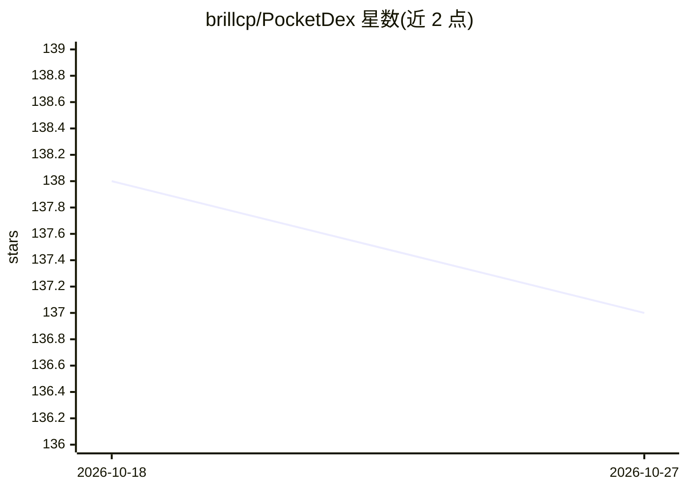

# brillcp/PocketDex

⭐ 137 · Swift · MIT · 推送 2026-10-22 · [GitHub](https://github.com/brillcp/PocketDex) · 个人维护

**SwiftUI 宝可梦图鉴与回合制对战示例应用，供 iOS 工程师学习**

基于 PokeAPI 的 SwiftUI 应用：浏览图鉴、查看宝可梦详情，并支持与基于规则的 AI 或本地好友进行回合制对战（MultipeerConnectivity）。架构采用 Protocol-Oriented MVVM，Swift 6 语言模式实现编译期数据竞争检查，SwiftData 作为数据源、网络仅作首次回填。AI 为 PokeBattleKit 的规则型对战 AI，经过全图鉴模拟测试，含三个难度等级。README 定位为现代 SwiftUI 模式的可读实例，代码带注释解释设计决策。

## 筛选速览

| 维度 | 判定 | 备注 |
|---|---|---|
| AI 角色 | `ai-enhanced` | 去掉 AI 部分产品仍成立 |
| 许可风险 | `permissive` | MIT |
| 部署形态 | `None` |  |
| 模型依赖 | — | README 未给出锁定关系 |
| 硬件要求 | — | 无带数字的原话,不猜 |
| 安装摩擦 | `low` | 无编译、无系统依赖或容器化 |
| 成熟度 | — | 结构信号不足 |

## 能力要点

- Swift 6 语言模式的编译期数据竞争检查（零警告）
- 规则型对战 AI（全图鉴模拟测试，三档难度）
- MultipeerConnectivity 本地多人对战（host 权威架构）
- SwiftData 为数据源、@ModelActor 后台导入管道

## 适用场景

- 学习 Swift 6 严格并发、actor 与 @Observable 的真实应用写法
- 浏览宝可梦图鉴并与规则 AI 回合制对战
- 参考 Protocol-Oriented MVVM 与依赖注入组织方式

## 场景标签

`教程课程` · 领域:学习与行业

## 证据(README 行号)

> L12: PocketDex+ is a SwiftUI app built on top of the PokeAPI, with a working turn-based Pokemon battle mode against a **
> L14: If you're a senior iOS engineer looking for a worked example of modern SwiftUI patterns (**Swift 6 strict concurren

## 星数曲线

2026-10-18 138 → 2026-10-27 137（-1）

---
*卡片 v1 · prompt 1.4 · 生成 2026-10-22 · 置信度 high · 依据 README sha `048c6d7c23ad` · [字段定义](../../DATASET.md)*
