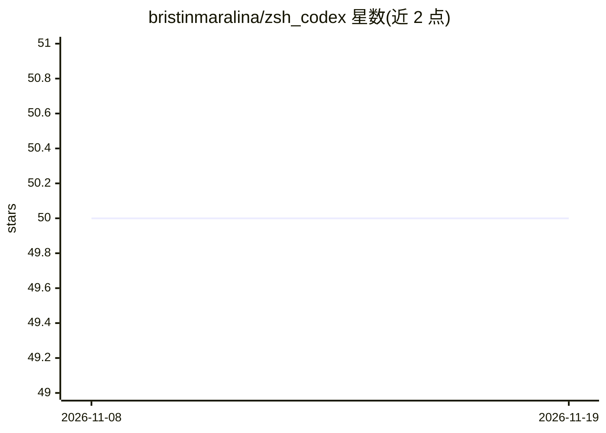

# bristinmaralina/zsh_codex

⭐ 50 · Python · MIT · 推送 2026-11-05 · [GitHub](https://github.com/bristinmaralina/zsh_codex) · 个人维护

**把自然语言注释转成 shell 命令的 Zsh 插件**

一个 ZSH 插件，用户在命令行写下注释或描述性文字后按 ^X，由 LLM 生成对应的 shell 命令补全。支持 OpenAI Codex 与 Google Gemini（Generative AI），也可通过 boto3 接入。通过 ~/.config/zsh_codex.ini 配置多个服务并选择使用，兼容 oh-my-zsh 与手动 source 两种加载方式，支持虚拟环境指定 Python。可选 PREEXECUTE_COMMENT 功能先用 zsh 执行上下文收集命令再交给 AI。当前文件系统上下文不会传给 AI，需自行传入或用命令收集。

## 筛选速览

| 维度 | 判定 | 备注 |
|---|---|---|
| AI 角色 | `ai-enhanced` | 去掉 AI 部分产品仍成立 |
| 许可风险 | `permissive` | MIT |
| 部署形态 | `library` | 以包/库形式分发 |
| 模型依赖 | — | README 未给出锁定关系 |
| 硬件要求 | — | 无带数字的原话,不猜 |
| 安装摩擦 | `low` | 无编译、无系统依赖或容器化 |
| 成熟度 | — | 结构信号不足 |

## 能力要点

- 注释→shell 命令的 LLM 补全，快捷键 ^X 触发
- 支持 OpenAI Codex、Google Gemini，或经 boto3 接入
- ini 配置文件可定义多个服务并切换
- ZSH_CODEX_PREEXECUTE_COMMENT 可先收集命令上下文再生成

## 适用场景

- 忘记命令语法时用自然语言描述让 AI 生成命令
- 在 oh-my-zsh 工作流中按 ^X 补全长命令
- 基于 git diff 等上下文生成提交推送组合命令

## 场景标签

`代码生成` · 领域:编码与开发

## 证据(README 行号)

> L31:  You just need to write a comment or variable name and the AI will write the corresponding code.
> L35: This is a ZSH plugin that enables you to use AI powered code completion in the command line. It now supports both O

## 星数曲线

2026-11-08 50 → 2026-11-19 50（+0）

---
*卡片 v1 · prompt 1.4 · 生成 2026-11-18 · 置信度 high · 依据 README sha `05c9041e7112` · [字段定义](../../DATASET.md)*
