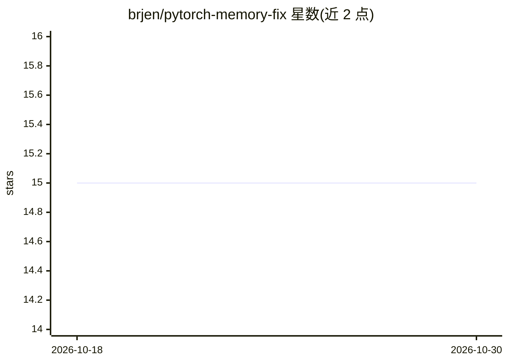

# brjen/pytorch-memory-fix

⭐ 15 · Python · MIT · 推送 2026-07-10 · [GitHub](https://github.com/brjen/pytorch-memory-fix) · 个人维护

**两个环境变量修复 Linux 上 PyTorch/glibc 内存增长问题**

面向在 Linux 上反复加载/卸载大模型（扩散模型、LLM 等）的 Python/PyTorch 用户的内存问题修复方案：通过设置 MALLOC_MMAP_THRESHOLD_ 与 MALLOC_TRIM_THRESHOLD_（64KB）强制大块分配走 mmap，避免 glibc 堆 arena 碎片化导致的 RSS 持续攀升与 OOM。README 给出 systemd/Docker/命令行三种应用方式、进程内 mallopt 兜底方案、verify_fix.py 验证脚本，并附实测数据。限制：仅适用 glibc（不适用 musl/Alpine、jemalloc），进程内 os.environ 设置无效，子进程需继承父进程环境。仓库本体是文档与验证脚本，无安装包。

## 筛选速览

| 维度 | 判定 | 备注 |
|---|---|---|
| AI 角色 | `ai-knowledge` | 知识聚合/清单类 |
| 许可风险 | `permissive` | MIT |
| 部署形态 | `self-host` | docker 或自建部署 |
| 模型依赖 | — | README 未给出锁定关系 |
| 硬件要求 | — | 无带数字的原话,不猜 |
| 安装摩擦 | `low` | 无编译、无系统依赖或容器化 |
| 成熟度 | — | 结构信号不足 |

## 能力要点

- 两个环境变量强制大块分配走 mmap，零代码改动
- 给出 systemd/Docker/命令行三种应用方式及进程内 mallopt 兜底
- verify_fix.py 通过 mallinfo2 验证修复是否生效
- 附 13 个模型循环加载卸载的实测 RSS 对比数据

## 适用场景

- 模型服务/渲染流水线反复加载卸载大模型导致内存被 OOM 杀掉
- 排查看起来像 Python 内存泄漏但 gc.collect() 无效的 RSS 增长
- 在 systemd/Docker 部署中为 ML 工作负载配置 glibc 分配器参数

## 场景标签

`MLOps` · 领域:训练与推理

## 证据(README 行号)

> L3: **TL;DR:** If you load and unload large models in Python/PyTorch on Linux, your process slowly eats all available RA
> L32: ## The Root Cause: glibc Arena Fragmentation
> L163: - **Any Python ML workload** that loads/unloads models: PyTorch, TensorFlow, JAX, ONNX

## 星数曲线

2026-10-18 15 → 2026-10-30 15（+0）

---
*卡片 v1 · prompt 1.4 · 生成 2026-10-30 · 置信度 mid · 依据 README sha `168f4611b589` · [字段定义](../../DATASET.md)*
