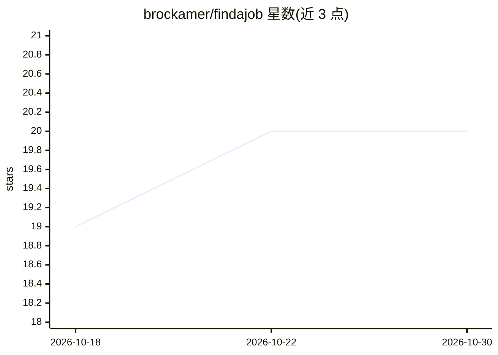

# brockamer/findajob

⭐ 20 · Python · MIT · 推送 2026-10-29 · [GitHub](https://github.com/brockamer/findajob) · 个人维护

**自托管求职管道：LLM 筛选职位并生成定制简历与求职信**

面向会用 Docker、终端与 git 的求职者/运营者自托管的求职管理系统：每日从 LinkedIn、Indeed、Greenhouse 及 Gmail 拉取职位，AI 按个人背景打分筛出少量值得投递的岗位；对选中的岗位调研公司并生成定制简历、求职信与外联草稿；被拒岗位打上原因标签用于训练次日打分。所有 AI 调用经 OpenRouter 计费（文档称典型月花费约 20–50 美元），通过 Docker Compose 部署，提供 Web UI。项目处于 pre-1.0，2026 年 10 月公告称正在全面审计，文档与行为可能随版本变化。

## 筛选速览

| 维度 | 判定 | 备注 |
|---|---|---|
| AI 角色 | `ai-native` | 本体是模型或模型工具 |
| 许可风险 | `permissive` | MIT |
| 部署形态 | `None` |  |
| 模型依赖 | locked-api |  |
| 硬件要求 | — | 无带数字的原话,不猜 |
| 安装摩擦 | `low` | 无编译、无系统依赖或容器化 |
| 成熟度 | `idea` | |

## 能力要点

- 从 LinkedIn/Indeed/Greenhouse/Gmail 拉取职位并用 LLM 按背景打分过滤
- 对选中岗位生成定制简历、求职信、公司简报与外联草稿
- 被拒岗位打原因标签，用于后续打分训练
- Docker Compose 部署，Web UI 分诊，含候选数据本地 state 目录与 PII 防护钩子

## 适用场景

- 每天自动汇集职位并用 AI 筛出值得投递的少数岗位
- 为每个目标岗位生成定制简历与求职信草稿
- 从拒绝结果中归因并调整后续筛选策略

## 场景标签

`AI 写作` `网页抓取` `工作流自动化` · 领域:效率与自动化

## 证据(README 行号)

> L3: **Self-hosted job search infrastructure: AI triages thousands of listings down to a handful, generates tailored mate
> L20: - **Writes the application for you to finish.** Flag a job and findajob researches the company and drafts a briefin

## 星数曲线

2026-10-18 19 → 2026-10-30 20（+1）

---
*卡片 v1 · prompt 1.4 · 生成 2026-10-28 · 置信度 high · 依据 README sha `6f417df04190` · [字段定义](../../DATASET.md)*
