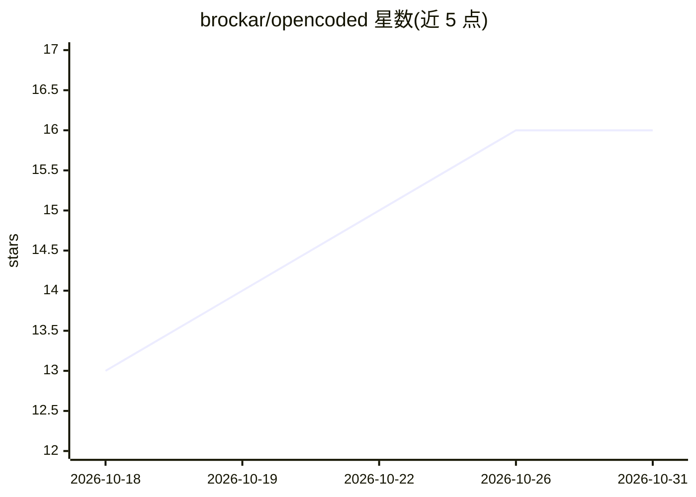

# brockar/opencoded

⭐ 16 · Shell · 推送 2026-07-27 · [GitHub](https://github.com/brockar/opencoded) · 个人维护

**OpenCode AI 的 Docker 容器化运行仓库，含 Web/TUI 两种模式**

将 AI 编码工具 OpenCode 打包进 Docker 的基础设施仓库：通过 Docker Compose、docker run 或 run.sh 脚本启动，支持浏览器 Web 界面（默认 4096 端口）与终端 TUI 模式，可同时运行多个实例。容器挂载项目目录、SSH 密钥、OpenCode 配置与 auth.json 以实现配置持久化，另提供 GHCR 镜像发布、标准/slim 两种 Dockerfile 与 shell 别名配置脚本。面向希望在隔离环境中运行 OpenCode 的开发者，本体不实现 AI 功能。

## 筛选速览

| 维度 | 判定 | 备注 |
|---|---|---|
| AI 角色 | `ai-ecosystem` | LLM/agent 周边工具 |
| 许可风险 | `none` | — |
| 部署形态 | `self-host` | docker 或自建部署 |
| 模型依赖 | — | README 未给出锁定关系 |
| 硬件要求 | — | 无带数字的原话,不猜 |
| 安装摩擦 | `low` | 无编译、无系统依赖或容器化 |
| 成熟度 | — | 结构信号不足 |

## 能力要点

- Docker Compose / docker run / run.sh 三种启动方式
- Web 界面与终端 TUI 双模式，支持多实例多端口
- SSH 密钥、配置与认证文件的卷挂载持久化
- 标准与 slim 两种镜像构建（apt/apk 各自定制）

## 适用场景

- 在隔离容器中运行 OpenCode 避免污染本机环境
- 在浏览器或终端里对指定项目目录使用 OpenCode
- 为不同项目分别运行独立容器实例

## 场景标签

`编码 Agent` · 领域:编码与开发

## 证据(README 行号)

> L7: This container runs OpenCode inside Docker. You can run OpenCode in web mode or terminal mode. The container include
> L42: Open the web interface at **<http://localhost:4096>**.

## 星数曲线

2026-10-18 13 → 2026-10-31 16（+3）

---
*卡片 v1 · prompt 1.4 · 生成 2026-10-30 · 置信度 high · 依据 README sha `696f0f2c6b89` · [字段定义](../../DATASET.md)*
