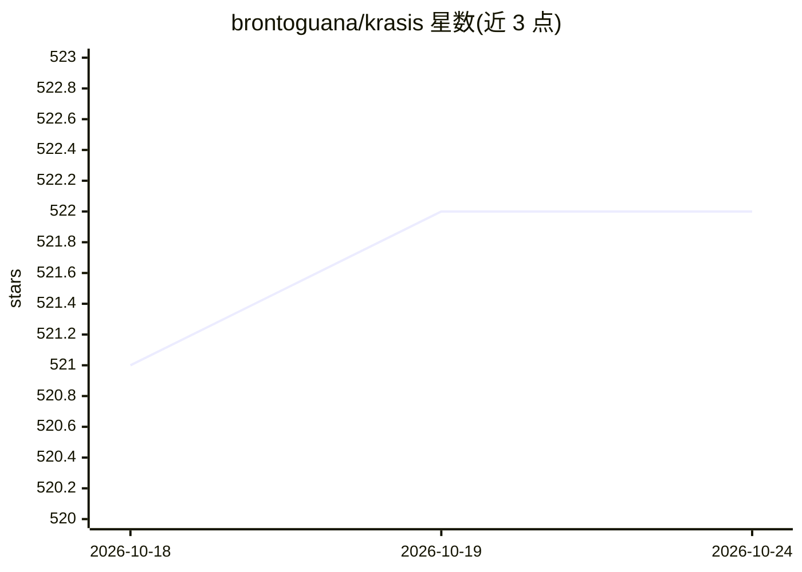

# brontoguana/krasis

⭐ 523 · C++ · NOASSERTION · 推送 2026-10-22 · [GitHub](https://github.com/brontoguana/krasis) · 组织维护

**在消费级 NVIDIA GPU 上运行超大 MoE 模型的 LLM 推理运行时**

面向 NVIDIA 消费级/工作站 GPU 的 LLM 运行时：运行数百 B 参数 MoE 模型，通过 GPU 全速 prefill、GPU 解码与 HCS 专家驻留管理（在 VRAM 与 CPU RAM 之间调度冷热专家），使模型大于 VRAM 时仍可本地运行。热路径使用 Rust/CUDA，构建 INT4/INT8 专家缓存与 HQQ 注意力缓存。提供交互式启动器、OpenAI 兼容 API、聊天客户端、Krasis Manager 管理面板与可复现基准。要求 Ampere 及以上 NVIDIA GPU 与 CUDA 驱动，输入为 BF16 safetensors，首次运行需构建缓存且较慢。

## 筛选速览

| 维度 | 判定 | 备注 |
|---|---|---|
| AI 角色 | `ai-ecosystem` | LLM/agent 周边工具 |
| 许可风险 | `none` | NOASSERTION |
| 部署形态 | `desktop` | 安装包/桌面程序 |
| 模型依赖 | — | README 未给出锁定关系 |
| 硬件要求 | — | 无带数字的原话,不猜 |
| 安装摩擦 | `medium` | 含编译或系统依赖之一 |
| 成熟度 | — | 结构信号不足 |

## 能力要点

- HCS 专家驻留管理：大于 VRAM 的 MoE 模型本地运行
- Rust/CUDA 热路径与 INT4/INT8 专家缓存、HQQ 注意力缓存
- OpenAI 兼容 API 与工具调用格式转换（含流式与多轮）
- Krasis Manager 本地控制面板与反向 SSH 隧道支持

## 适用场景

- 在有限 VRAM 的消费级 NVIDIA GPU 上本地运行数百 B 参数 MoE 模型
- 通过 OpenAI 兼容 API 为本地模型提供服务
- 用管理面板监控与调度多 GPU 上的模型实例
- 复现发布方提供的性能基准进行选型评估

## 场景标签

`推理引擎` · 领域:训练与推理

## 证据(README 行号)

> L10: Krasis is an LLM runtime for running large MoE models on NVIDIA consumer GPUs.
> L57: - Provides an interactive launcher, OpenAI-compatible API, chat client,

## 星数曲线

2026-10-18 521 → 2026-10-24 522（+1）

---
*卡片 v1 · prompt 1.4 · 生成 2026-10-21 · 置信度 high · 依据 README sha `31f22696f7d8` · [字段定义](../../DATASET.md)*
