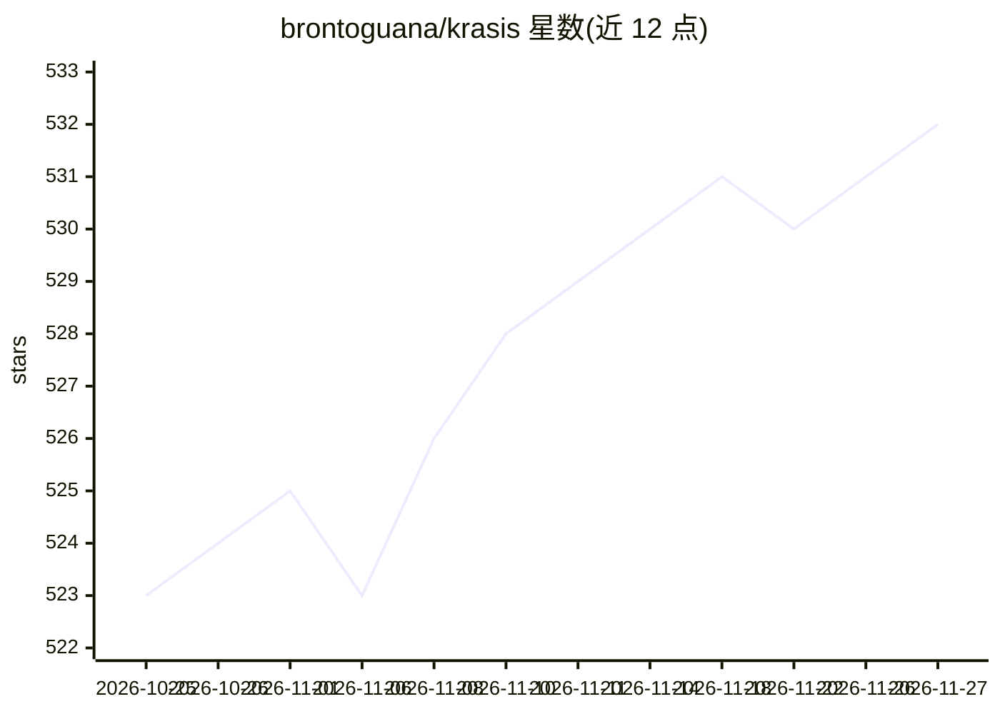

# brontoguana/krasis

⭐ 532 · C++ · NOASSERTION · 推送 2026-11-12 · [GitHub](https://github.com/brontoguana/krasis) · 组织维护

**在消费级 NVIDIA GPU 上本地运行大型 MoE 模型的推理运行时**

面向 NVIDIA 消费级 GPU 的混合 LLM 推理运行时，由 Northloom 开发，聚焦在 VRAM 受限硬件上运行远超显存容量的 MoE 大模型。机制上采用全 GPU prefill、GPU 执行的 decode、HCS 专家驻留管理（在 VRAM 与 CPU RAM 间调度冷热专家），构建 INT4/INT8 专家缓存与 HQQ 注意力缓存，支持紧凑 KV cache（k6v6/k4v4）。提供交互式启动器、OpenAI 兼容 API、聊天客户端、Krasis Manager 管理面板与可复现基准测试。性能敏感路径为 Rust/CUDA，Python 用于启动/加载；支持 Windows 安装包与 Linux/WSL2 脚本安装。

## 筛选速览

| 维度 | 判定 | 备注 |
|---|---|---|
| AI 角色 | `ai-ecosystem` | LLM/agent 周边工具 |
| 许可风险 | `none` | NOASSERTION |
| 部署形态 | `desktop` | 安装包/桌面程序 |
| 模型依赖 | — | README 未给出锁定关系 |
| 硬件要求 | — | 无带数字的原话,不猜 |
| 安装摩擦 | `medium` | 含编译或系统依赖之一 |
| 成熟度 | `idea` | |

## 能力要点

- HCS 专家驻留管理：让参数量远超 VRAM 的 MoE 模型在本地运行
- INT4/INT8 专家缓存与 HQQ 注意力、紧凑 KV cache（k6v6/k4v4）
- OpenAI 兼容 API，含模型原生 tool-call 语法到结构化 tool_calls 的转换
- Krasis Manager 控制面板按 GPU UUID 管理模型、端口与显存占用

## 适用场景

- 在单张 32GB 消费级显卡上本地运行百亿到数百亿参数的 MoE 模型
- 本地部署带工具调用能力的 LLM 服务并通过 OpenAI 兼容 API 接入
- 多 GPU 环境下通过管理面板分配与监控模型服务
- 在无公网端口条件下通过反向 SSH 隧道对外暴露本地服务

## 场景标签

`推理引擎` `模型量化` · 领域:训练与推理

## 证据(README 行号)

> L10: Krasis is an LLM runtime for running large MoE models on NVIDIA consumer GPUs.
> L63: - Provides an interactive launcher, OpenAI-compatible API, chat client,
> L64:  reproducible benchmarks, and GitHub-release based installation.

## 星数曲线

2026-10-25 523 → 2026-11-27 532（+9）

---
*卡片 v1 · prompt 1.4 · 生成 2026-11-25 · 置信度 high · 依据 README sha `e480875ede09` · [字段定义](../../DATASET.md)*
