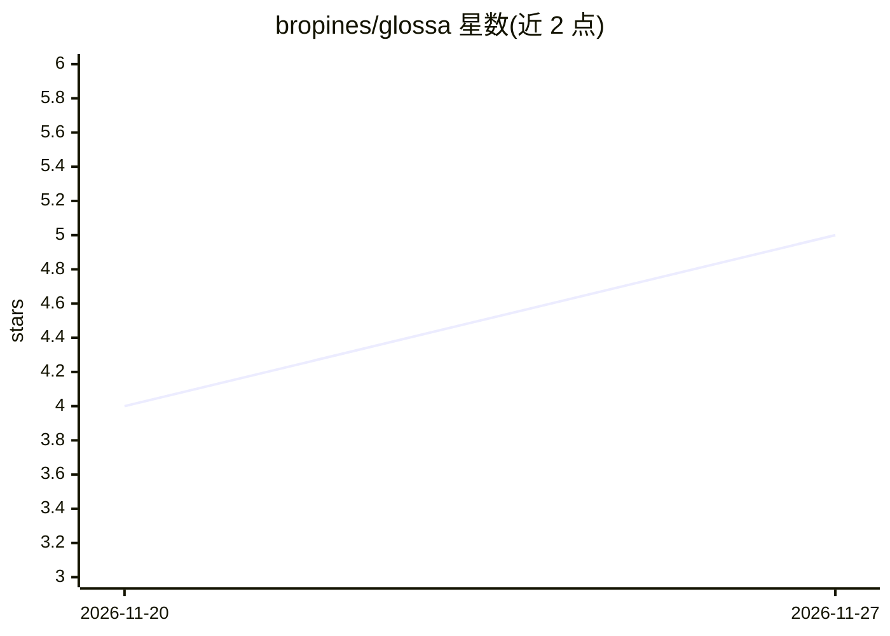

# bropines/glossa

⭐ 5 · Rust · Apache-2.0 · 推送 2026-11-23 · [GitHub](https://github.com/bropines/glossa) · [官网](https://github.com/bropines/glossa/releases) · 个人维护

**全局划词桌面翻译工具：任意程序选文本按热键即得翻译**

以 Rust 编写的跨平台桌面翻译器（Windows/macOS/Linux），在任意程序中选中文字按热键即弹出光标旁的翻译。内置多家免密钥翻译服务，支持配置 API 密钥的服务与任意 OpenAI 兼容端点作为 AI 翻译器；屏幕区域 OCR 内置 Google Lens 并提供离线引擎；支持在线/离线词典、朗读、鼠标模式、JavaScript/Python/Java 等模块扩展、命令行与本地 HTTP API。安装包未签名，Linux 尚处实验阶段。

## 筛选速览

| 维度 | 判定 | 备注 |
|---|---|---|
| AI 角色 | `ai-enhanced` | 去掉 AI 部分产品仍成立 |
| 许可风险 | `permissive` | Apache-2.0 |
| 部署形态 | `desktop` | 安装包/桌面程序 |
| 模型依赖 | local-ok | 支持本地模型 |
| 硬件要求 | — | 无带数字的原话,不猜 |
| 安装摩擦 | `medium` | 含编译或系统依赖之一 |
| 成熟度 | `idea` | |

## 能力要点

- 划词热键翻译、鼠标模式与整屏/区域 OCR 翻译
- 支持任意 OpenAI 兼容端点（含本地 Ollama/LM Studio）作为 AI 翻译器，流式输出
- OCR 内置 Google Lens 免安装，离线回退到 Windows OCR/Apple Vision/Tesseract
- 多语言模块扩展协议，兼容经典 QTranslate 服务与 pot-app 插件

## 适用场景

- 在任意程序中划词即时翻译外文内容
- 对屏幕上无法复制的文字做 OCR 翻译
- 用本地模型或自有 API 密钥搭建私人翻译端点
- 从 QTranslate 迁移服务、主题与设置

## 场景标签

`OCR` `语音合成` · 领域:内容生成

## 证据(README 行号)

> L3:  A fast, small, extensible desktop translator.
> L125: - **AI translators**: any number of OpenAI-compatible endpoints (OpenAI,
> L139: - Google Lens is built in and needs nothing installed. Offline: Windows OCR

## 星数曲线

2026-11-20 4 → 2026-11-27 5（+1）

---
*卡片 v1 · prompt 1.4 · 生成 2026-11-21 · 置信度 high · 依据 README sha `3a3163eddde5` · [字段定义](../../DATASET.md)*
