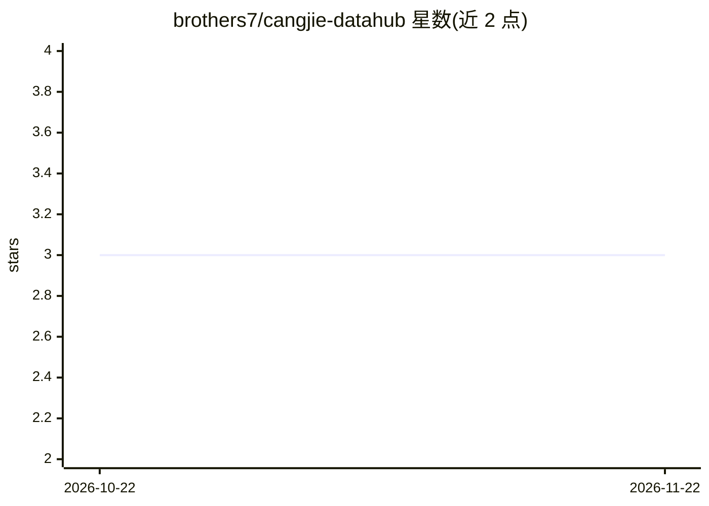

# brothers7/cangjie-datahub

⭐ 3 · Python · MIT · 推送 2026-11-03 · [GitHub](https://github.com/brothers7/cangjie-datahub) · [官网](https://github.com/brothers7/cangjie-datahub) · 个人维护 · 中文 README

**企业数据分析的 AI 数仓工作台：自然语言问数与自动建模调度**

开源 AI 数仓工作台，覆盖从提问到生产的完整链路：自然语言问答生成受守卫的 SQL 并渲染图表、内置编码代理设计星型模型并自动推导依赖、内置调度器对接 Azkaban/Airflow、知识图谱存储语义元数据、六域数据治理检查。安全机制包括 SELECT-only AST 守卫、凭据 AES-256-GCM 加密、技能沙箱、定时写操作双重人工审批。支持 MySQL/PostgreSQL/ClickHouse/Hive/Doris 等 8 种数据源，中英双语 UI，docker compose 一键运行并附带演示数据。

## 筛选速览

| 维度 | 判定 | 备注 |
|---|---|---|
| AI 角色 | `ai-native` | 本体是模型或模型工具 |
| 许可风险 | `permissive` | MIT |
| 部署形态 | `self-host` | docker 或自建部署 |
| 模型依赖 | — | README 未给出锁定关系 |
| 硬件要求 | — | 无带数字的原话,不猜 |
| 安装摩擦 | `low` | 无编译、无系统依赖或容器化 |
| 成熟度 | — | 结构信号不足 |

## 能力要点

- 自然语言→受守卫 SQL→图表→ETL→定时任务的完整链路
- 内置编码代理（最多 8 步 agentic loop）设计数仓模型并自动推导依赖
- sqlglot AST 级 SQL 守卫：仅限 SELECT、表白名单、强制 LIMIT
- 三级角色权限、登录限速、全量审计日志

## 适用场景

- 业务人员用中文直接查询数仓指标并生成图表
- 让 AI 代理从需求设计星型模型并落成定时 ETL 任务
- 对现有数仓做元数据、质量、成本的安全巡检

## 场景标签

`数据分析` `知识图谱` `工作流自动化` · 领域:效率与自动化

## 证据(README 行号)

> L12: > **Cangjie DataHub** is an open-source, AI-native data warehouse workbench:
> L23: - 🤖 **AI-native, not AI-bolted-on** — a four-layer agent foundation (intent routing → skill pipeline → knowledge gr
> L56: - **SQL generation pipeline** — question rewriting → candidate table recall (metadata + knowledge graph + vector se

## 星数曲线

2026-10-22 3 → 2026-11-22 3（+0）

---
*卡片 v1 · prompt 1.4 · 生成 2026-11-22 · 置信度 high · 依据 README sha `9086ee0d8ebe` · [字段定义](../../DATASET.md)*
