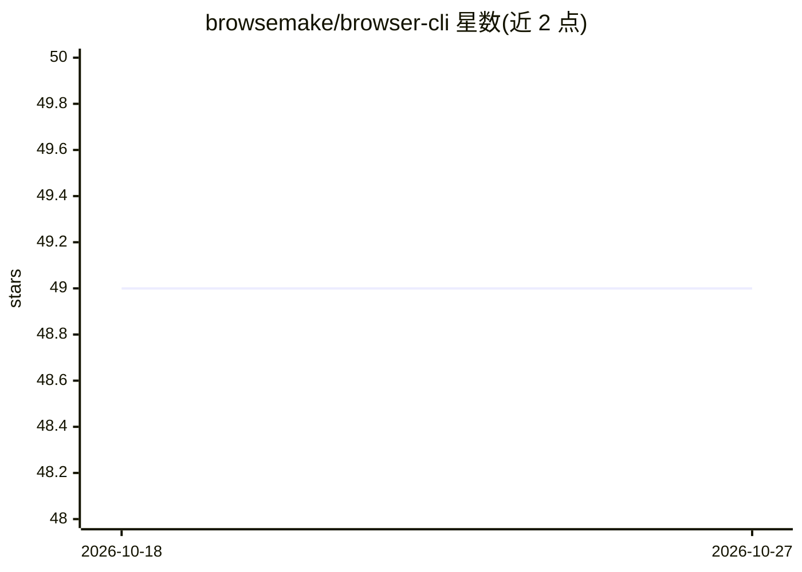

# browsemake/browser-cli

⭐ 49 · JavaScript · MIT · 推送 2026-10-25 · [GitHub](https://github.com/browsemake/browser-cli) · 组织维护

**供 LLM agent 调用的浏览器自动化命令行工具**

以 npm 分发的 CLI 工具 `br`，基于 Playwright 驱动 headless Chromium 浏览器，供 ChatGPT、Claude Code、Gemini CLI 等 LLM agent 调用执行网页导航、点击、填表、截图、标签管理等浏览器操作，也可由人直接在命令行使用。后台以守护进程方式运行并暴露 HTTP API，会话间保持进度；输出面向 LLM 优化，提供无障碍树视图与错误提示，并带密码隔离的密钥管理与操作历史回放。

## 筛选速览

| 维度 | 判定 | 备注 |
|---|---|---|
| AI 角色 | `ai-ecosystem` | LLM/agent 周边工具 |
| 许可风险 | `permissive` | MIT |
| 部署形态 | `library` | 以包/库形式分发 |
| 模型依赖 | — | README 未给出锁定关系 |
| 硬件要求 | — | 无带数字的原话,不猜 |
| 安装摩擦 | `low` | 无编译、无系统依赖或容器化 |
| 成熟度 | — | 结构信号不足 |

## 能力要点

- 守护进程常驻运行，跨 LLM 会话保持浏览器进度
- 无障碍树结构化页面视图与元素 ID/XPath 映射
- 密钥管理将密码与 LLM 隔离，view-html 时掩码显示
- 操作历史记录，支持回放与脚本化

## 适用场景

- 让 ChatGPT/Claude Code/Gemini CLI 等 agent 代我完成网页操作（购物、下载账单、搜索招聘信息）
- 通过命令行自动化浏览器任务
- 在不把凭据交给 LLM 的前提下自动登录网站

## 场景标签

`浏览器自动化` · 领域:效率与自动化

## 证据(README 行号)

> L6: `br` is a command line tool used by any capable LLM agent, like ChatGPT, Claude Code or Gemini CLI.
> L12: - **AI first**: designed for LLM agent, readable view from HTML, and error hint

## 星数曲线

2026-10-18 49 → 2026-10-27 49（+0）

---
*卡片 v1 · prompt 1.4 · 生成 2026-10-24 · 置信度 high · 依据 README sha `ed9ac9af7ec0` · [字段定义](../../DATASET.md)*
