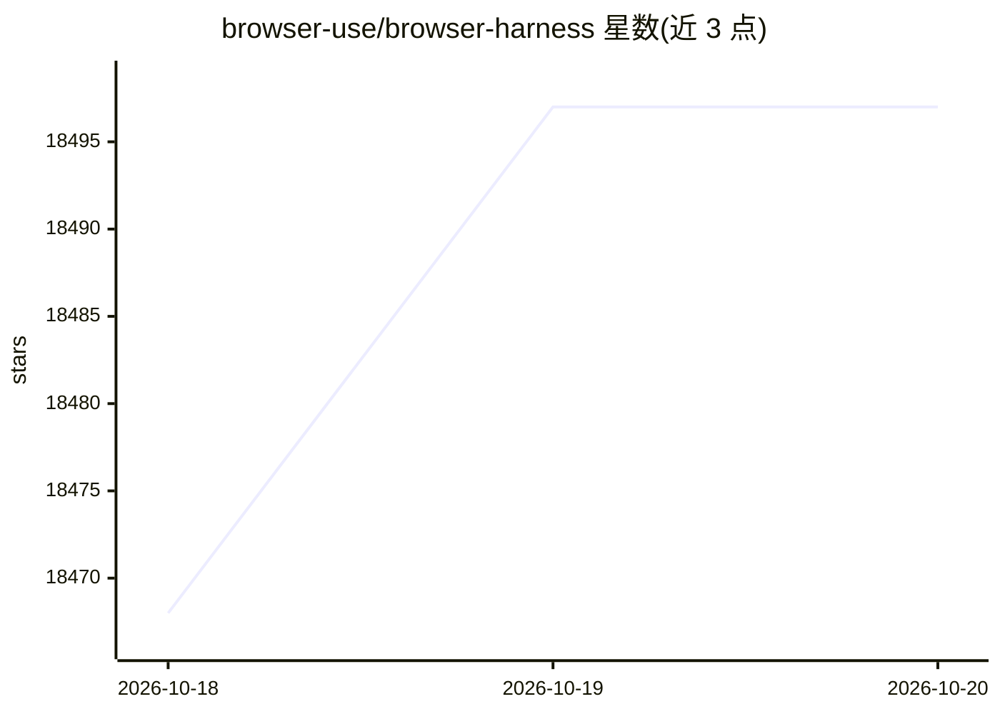

# browser-use/browser-harness

⭐ 18,497 · Python · MIT · 推送 2026-10-17 · [GitHub](https://github.com/browser-use/browser-harness) · [官网](https://browser-harness.com) · 组织维护

**让编码 Agent 驱动真实 Chrome，以登录态完成浏览器操作**

通过一段 setup prompt 将 Claude Code、Codex 或 Cursor 连接到用户本机已登录的 Chrome：经 DevTools Protocol（CDP）通信，支持打开页面、点击、输入、读取与下载。Agent 运行时在本地工作区补写可复用 helper，`SKILL.md` 提供工作流说明，`src/` 目录保持受保护。另提供 `browser-harness-mcp`，经 stdio 将浏览器控制 helper 暴露为 MCP 工具供任意 MCP 客户端调用。MIT 许可。

## 筛选速览

| 维度 | 判定 | 备注 |
|---|---|---|
| AI 角色 | `ai-enhanced` | 去掉 AI 部分产品仍成立 |
| 许可风险 | `permissive` | MIT |
| 部署形态 | `None` |  |
| 模型依赖 | — | README 未给出锁定关系 |
| 硬件要求 | — | 无带数字的原话,不猜 |
| 安装摩擦 | `low` | 无编译、无系统依赖或容器化 |
| 成熟度 | — | 结构信号不足 |

## 动量与使用信号

- 维护:`active` — 距上次 push 3.3 天,年发版 14,86 位贡献者
- 涨星:近 1 天 **+15**(自 20261016 起算)
- 平台:— · 协议:MCP

## 能力要点

- 通过 CDP 连接用户真实已登录 Chrome 执行操作
- Agent 运行时自动补写可复用 helper
- 提供 browser-harness-mcp，支持任意 MCP 客户端驱动浏览器
- setup prompt 一步安装（uv + Python 3.12）

## 适用场景

- 让编码 Agent 以我的登录态抓取或下载网页内容
- 自动化日常网页操作而无需自己打开浏览器
- 通过 MCP 客户端直接驱动浏览器任务

## 场景标签

`浏览器自动化` `编码 Agent` · 领域:效率与自动化

## 证据(README 行号)

> L5: Browser Harness lets Claude Code, Codex or Cursor use your real Chrome browser: open pages, click, type, read and do
> L45: Use your local browser for logged-in, personal work. When you want many browsers in parallel—with live previews, pr
> L49: `browser-harness-mcp` exposes the browser control helpers as MCP tools over

## 星数曲线

2026-10-18 18,468 → 2026-10-20 18,497（+29）

---
*卡片 v1 · prompt 1.4 · 生成 2026-10-18 · 置信度 high · 依据 README sha `a4e7126f9696` · [字段定义](../../DATASET.md)*
