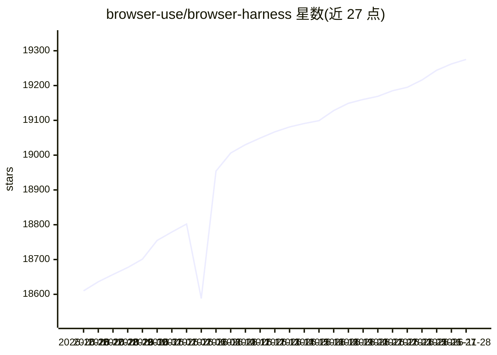

# browser-use/browser-harness

⭐ 19,275 · Python · MIT · 推送 2026-11-27 · [GitHub](https://github.com/browser-use/browser-harness) · [官网](https://browser-harness.com) · 组织维护

**让编码 Agent 接管你已登录的真实 Chrome 浏览器**

Browser Harness 通过 Chrome DevTools Protocol（CDP）让 Claude Code、Codex 或 Cursor 等编码 Agent 操作用户本人已登录的 Chrome：打开页面、点击、输入、读取和下载文件。安装方式为向编码 Agent 粘贴一段 setup prompt，Agent 自动完成连接配置；工作过程中 Agent 在本地 workspace 编写可复用 helper，SKILL.md 提供浏览器工作流说明。现作为 Browser Use 的引擎，提供 `browser-use --cli-mcp` 的 MCP 服务器供任意 MCP 客户端使用；也提供 Browser Use Cloud 用于多浏览器并行场景。

## 筛选速览

| 维度 | 判定 | 备注 |
|---|---|---|
| AI 角色 | `ai-ecosystem` | LLM/agent 周边工具 |
| 许可风险 | `permissive` | MIT |
| 部署形态 | `None` |  |
| 模型依赖 | — | README 未给出锁定关系 |
| 硬件要求 | — | 无带数字的原话,不猜 |
| 安装摩擦 | `low` | 无编译、无系统依赖或容器化 |
| 成熟度 | — | 结构信号不足 |

## 动量与使用信号

- 维护:`active` — 距上次 push 3.3 天,年发版 14,86 位贡献者
- 涨星:近 1 天 **+15**(自 20261016 起算)
- 安装:github 包 `release-assets` 月下载无数据
- 平台:— · 协议:MCP

## 能力要点

- 通过 CDP 驱动用户已登录的真实 Chrome，保留登录态
- 粘贴 setup prompt 即可由编码 Agent 自动完成配置
- Agent 运行时自动编写可复用 helper，源码目录受保护
- 提供 MCP 服务器（browser-use --cli-mcp）供任意 MCP 客户端接入

## 适用场景

- 让编码 Agent 以我的登录身份操作网页（如下载我账号下的视频）
- 在 Cursor 中通过 MCP 配置接入浏览器控制
- 需要多浏览器并行、代理与验证码处理时使用配套云服务

## 场景标签

`浏览器自动化` · 领域:效率与自动化

## 证据(README 行号)

> L4: > **Browser Harness is now the engine inside Browser Use.** Use the `browser-use` CLI: same helpers and daemon, plus
> L18: Browser Harness lets Claude Code, Codex or Cursor use your real Chrome browser: open pages, click, type, read and d
> L105: `browser-use --cli-mcp` exposes the browser control helpers as MCP tools over

## 星数曲线

2026-10-26 18,610 → 2026-11-28 19,275（+665）

---
*卡片 v1 · prompt 1.4 · 生成 2026-11-23 · 置信度 high · 依据 README sha `ab0f9bfe895e` · [字段定义](../../DATASET.md)*
